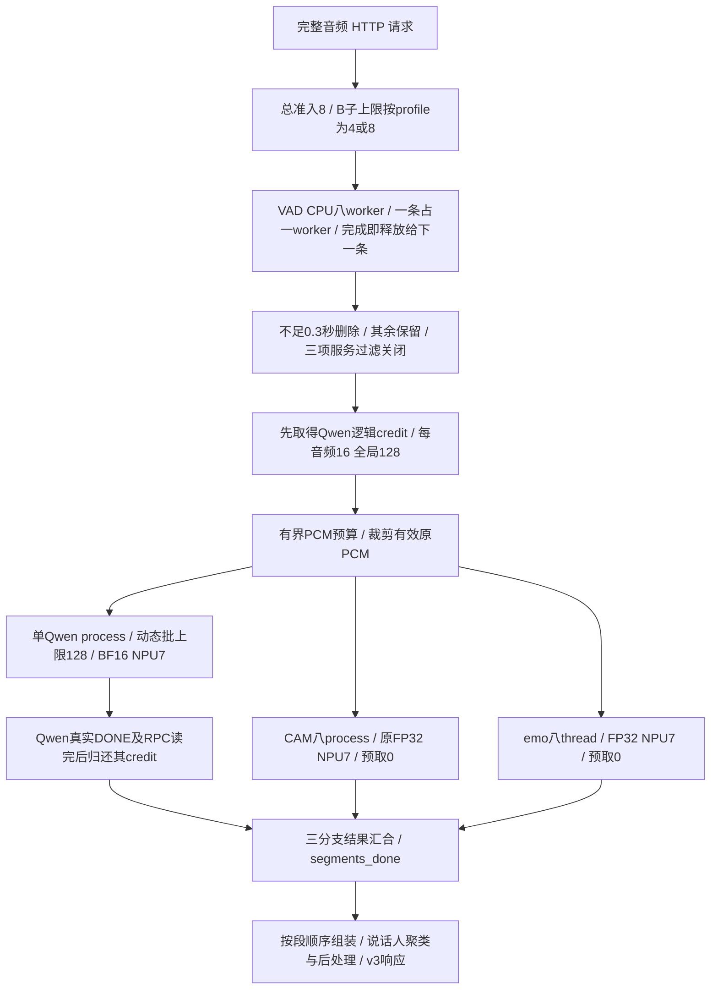
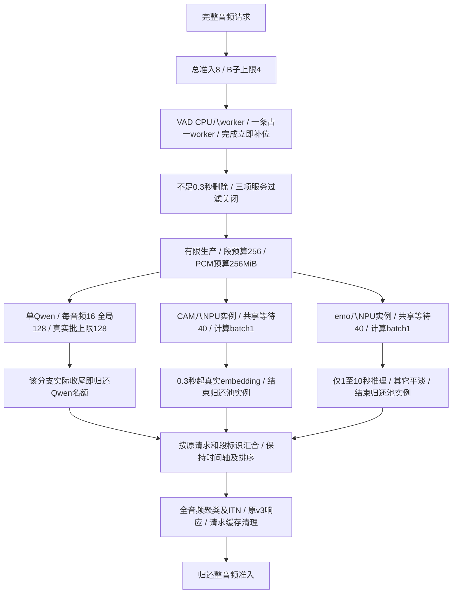

# 启动预加载与请求入口补充（2026-11-19，完整性能仍未验收）

当前 **43/59任务完成**（新增并完成2.9/3.7），本次代码补充不更改旧完整性能失败、不归档或推广默认。

- 根/容器配置保留懒加载与原窗口；显式preload_on_startup=false。单Qwen test/config.qwen128.toml及-b8.toml启用就绪前权重/processor预加载、16/128逻辑段窗口、物理批最多128；B4默认与B8独立，参数重启生效，不是在线权重替换。
- NPU:7真实load-only启动33.659秒完成八CPU VAD和一份Qwen，首次GET显示loaded/健康1、实际batch_count=0（没有转写），随后main exit0、无force、31个登记出生身份退出、私有cache空、port观察5秒、既有共享服务保留。不是所有shape暖身或完整性能通过，也不替代批128旧组件证据。
- 当前源码完整隔离CPU **1001 passed / 281子测试 / 2既定保护专属skip / 1硬件探针排除，234.74秒**。源码/profile无漂移、自有进程归零、共享cache写删尝试0，真实torch_npu未导入；可选发现的一次尝试被原guard阻断。新预加载22项、请求客户端11项目标CPU亦通过。当前保护构建/双Qwen及最终完整矩阵仍待8.8等任务验收。
- test/v3_request.py为既有服务请求客户端，支持真实multipart、A/B及完整音频1/2/4/8、GBK路径、420秒停追加与诊断，默认不保存原正文、不启动或关闭别人服务；示例见test/README.md。
- 只读语料52WAV+2MP3（SHA去重52音频、WAV去重50），均40～55分钟；没有新增A8完整性能结果。历史纯Qwen同128段曲线中64→128吞吐增加35.2%，128为最高已测而非已知最优，未测>128。

紧凑证据：npu-throughput-20261118/preload-request-validation-20261119.json。以下原v18及更早检查点按冻结范围保留，不覆盖本节。

---

# NPU转写吞吐与调度验证记录（2026-11-19实施检查点，尚未验收）

当前change为`2026-11-18-npu-asr-throughput-scheduling`，远程任务清单 **41/57完成**。用户要求将必要代码提交推送，本次保存阶段性实现，不代表完整性能通过、正式默认推广或OpenSpec归档。

- 单Qwen真实批128及八CAM/八emo组件验证已完成；固定128段约4.8～5.0秒只适用于组件，不能代替完整音频。
- v17冻结源码完整CPU948通过、281子测试、2既定保护专属skip；保护版本950通过、281子测试、0skip。均独立排除原1项硬件探针，CPU保护与私有缓存所有权核验通过。该结果不覆盖随后新增的双Qwen代码。
- v17保护版完整8B预检在420.027秒触发在途诊断，3/8完成。Qwen显式关闭宽限30秒超时后强制回收，main exit1；277个登记出生身份均退出、私有缓存空及端口观察释放，但**性能与正常关闭均失败**。不能把三条成功样本视为N=8合格成绩。
- 双Qwen条件回退代码已进入工作区：process模式支持1～8个受校验实例，先验证2×64、每音频16／全局128；首次全体发现、缓存后健康降级、不自动重启、drain后并发关闭、attempt实例归属均有CPU测试。目标CPU112项/95子测试通过；**双实例NPU、对应保护版本与完整音频矩阵尚未通过**。4／8份没有实测容量承诺。
- 双份候选显式关闭宽限120秒仅控制关闭等待，不改变业务推理timeout或420秒性能闸门。两个真实暖身的测试工具仍在临时草稿中，未随本次作为已验收实现交付。
- 根配置仍为此前单Qwen、batch1、段／全局1／1及原VAD／小模型池；本轮高并发配置使用独立profile，未推广默认。最终1／2／4／8同源A/B各两轮及混合交换共18轮仍未验收。
- 原始音频、模型、日志及旧失败保留。提交的五份转写结果证据已按SHA及字符数压缩，原正文副本在ignored logs中，映射见`npu-throughput-20261118/delivery-data-sanitization-v18.json`。设备生成的fusion_result变动另存备份，不随本次提交。

本次当前源码完整隔离CPU回归 **968 passed / 281子测试 / 2既定保护专属skip / 1硬件探针排除，237.17秒**。required节点通过，源码及profile未漂移、自有进程归零、共享cache写删尝试0；未导入真实torch_npu（可选backend发现的一次导入尝试被保护阻止）。OpenSpec严格校验通过。当前双份保护/NPU与最终矩阵仍待验收。

本次提交前完整CPU回归及证据索引见`npu-throughput-20261118/v18-precommit-checkpoint.json`；是否通过以该文件最终记录为准。以下为各冻结历史检查点原文，历史“当前／最新／正在执行”的描述仅适用于对应版本，不能覆盖本节。

---

# NPU 转写吞吐与调度验证记录（当前权威状态：v16，完整性能未验收）

**v16最新检查点：42/54。** 源码完整CPU919通过、281子测试、2既定保护专属skip；保护实际35so完整CPU921通过、281子测试、0skip，均独立排除原1项硬件探针。4个状态相关模块重编、31个精确复用，205项输入稳定，所有自有CPU进程及cache保护通过。新状态HTTP窗口8完整记录／直接JSONResponse已在源码真实NPU加载状态验证，尚未把它称作完整性能通过。

v16单首完整文件B诊断1/1完成，批墙钟109.063秒并正常关闭；B8仍持续大小批碎片，观测到321.552秒时主动仅向精确owned benchmark CLI发一次SIGINT，正式墙钟326.468秒、0/8/incomplete。**这是提前诊断，不是420秒触发。** 实际warmup.json为complete；取消摘要未附warmup/shutdown，须单独核对shutdown.json：main0、TERM至退出40.895秒、cache空、port5、无强制/孤儿、265个登记出生身份及driver/sampler均已退出，共享服务保留。最终18轮仍未开始。

额外只读状态观察器≤0.2Hz，SIGINT前62次均成功，HTTP+body+JSON P50/P95=82.116/159.887ms；关闭后3次ReadTimeout/reset/refused错误完整保留，未混入前段分位数。history观测ID1～40无检测缺口，last selected41不冒充完整执行41；resource cache age P50/P95=2.785/7.126秒是另一口径。紧凑证据见`npu-throughput-20261118/v16-status-window-validation.json`。后续先测真实裁剪/编码后的补位延迟，优先在已支持参数内标定等待窗口；多Qwen仅临时条件草稿，未进入运行代码，不恢复大批盲跑。

独立重建旧慢batch63的16段（8段有CAM实发PCM SHA交叉验证）在单Qwen、无NN孤立环境一暖三稳：调用3.364/3.429/3.419秒，generate3.255/3.321/3.309秒；首音频+prefill约0.18秒，49次缓存decode forward合约3.0秒、调用线程CPU约2.96～3.03秒，16/16均EOS、cap0。此观测不是旧整服务7.617秒的匹配对照，不能断言GIL或共享卡根因。仅暖轮profile记录CANN编译约1.1秒；不同host/API/device累计不可相加，记录任务区间覆盖率14%不是AICore利用率。原trace和失败export参数原件保留。

以下为v14及v15历史检查点（按各自冻结范围保留）；其“正在执行”等状态不覆盖上面的v16最新结果。

本报告对应 `2026-11-18-npu-asr-throughput-scheduling`。本次任务进度为 **41/54**（v16状态开销修正复开2.8/8.8）；源码与保护版的隔离 CPU 回归、固定128段组件、HTTP准入和取消收尾已在各自范围通过。**最新完整八文件B8预检在420.463秒触发诊断，3项完成、5项取消，未通过性能门槛；最终18轮完整音频矩阵尚未开始。** v15首文件B诊断已完成1/1；B8 wait50诊断也已触发420秒闸门（2完成/6取消），正常关闭；状态开销修正进入CPU/保护/实机复验，尚未完成。

以下“当前权威结果”覆盖此前版本状态。末尾原报告作为历史附录逐字保留，旧通过仅适用于当时范围，旧失败不改写为通过。组件128段约5秒不能代替一条40～55分钟完整音频的端到端结果。

## 当前环境与处理边界

远程为 `xjtu910b7:/home/zhangs/asr_nvidia`，使用 `/home/zhangs/conda-envs/asr/bin/python`。物理NPU:7同时承载一个Qwen模型进程、八个CAM模型进程及八个emo线程实例；VAD为八个CPU worker。既有共享uvicorn PID1601397及其出生身份始终保留，本机不是独占性能环境。保护版本为 `/tmp/asr-throughput-cython-v14-20261119-gjlxoc91`，35个实际.so；其源码冻结、编译与逐版二进制复用链单独核对，源.py的SHA不与.so的SHA混为一谈。

候选profile明确设置单Qwen process、批上限128、每音频16／全局128逻辑名额、CAM/emo预取0、VAD八CPU、CAM八NPU进程、emo八NPU线程；三项服务能量过滤false，仅保留0.3秒最短段门槛。B4与独立B8 profile仅B准入上限4→8不同。当前仓库安全默认与待推广候选分开，完整性能未验收前不据组件结果宣称默认已定案。

完整音频总准入和B子上限是接口容量门槛，超限返回原业务码。VAD完成即释放worker，不等待该音频的下游。Qwen名额在PCM申请前取得，避免第一音频先占满段缓存；Qwen完成即可归还，不等待CAM/emo汇合。CAM/emo的实际完成进度各自更新，段完成仍等所有所需分支。A类关闭说话人/情绪分支；`showRoleIdentify`保持false。0.3至不足1秒CAM实际处理，emo标“平淡”跳过；不足0.3秒不进入三个模型及响应。emo实际推理有效区间沿已验证规则，未改数学或精度。

420秒诊断检查完成请求P50/P95及所有在途请求年龄；120秒无真实进展也诊断。预热只将可信READY／真实加载完成计入进展，出生、CPU/HBM和采样时间变化不能掩盖卡住。触发后停止追加，保留所有未完成项，按owned服务单次TERM、10秒HTTP drain、模型DONE／lifespan收尾、240秒拥有者期限与至少5秒端口观察执行。未扩大生产业务HTTP超时，不用第二次SIGINT绕过收尾，不删除共享缓存。

## 当前已合格的组件与功能范围

| 项目 | 当前证据与结果 | 适用边界 |
| --- | --- | --- |
| 源码隔离CPU回归 | 902通过、281子测试通过、2跳过；外层exit0 | 显式排除1项真实硬件状态测试；不是NPU性能测试 |
| 保护版隔离CPU回归 | 904通过、281子测试通过、0跳过；35个实际.so、真实spawn入口通过 | 同样排除1项真实硬件状态测试 |
| CPU缓存隔离与安全保护 | 私有短TMPDIR；全局缓存mutation尝试0；元数据可读；自有149／148个登记出生身份全退出 | 各有1次可选torch_npu探测被保护阻断，实际未导入；不笼统称所有guard事件0 |
| Qwen原生批与前端 | 前端独立single特征后collate；本轮固定128每轮实际1×128 | 特征等价不保证不同BF16批shape文本逐字等价；当前source/so同shape另作数值对照 |
| CAM短段／精度及进程 | 原FP32计算、原参数/缓冲设备身份、192维结果和子进程DONE／退出身份检查 | 未作人工说话人准确率判断；emo原接口7分数，未补造9分数 |
| 源码／保护版固定128组件 | 各1暖身+3稳态；每轮128个Qwen原始/解析输出一致，CAM128×192、emo108×7及标签最大差0 | 满足1e-5数值门槛；不含完整VAD／HTTP／后处理 |
| Qwen拥有者边界 | .so真实worker；部分/重复取消、非法语言4009、0.01秒timeout4012、aclose三阶段通过 | 测试gate位于真实DONE、同步及完整RPC读回之后；不冒充执行中kernel可取消 |
| 源码／保护版HTTP准入 | 每轮15响应：12基础成功，第5B=4017，总8时第9A/B=4013；实观4B与总8/B4 | 真实4.1秒短片功能验证，非整音频并发性能 |
| 私有服务缓存与正常关闭 | 预热/基础请求13条实际缓存路径与诊断目录一致；cache空、scan_error=None、main0、无force/orphan、端口5秒、全部出生身份gone | 每轮独有TMPDIR保留，不删除目录／日志／外部缓存 |
| 源码与保护版HTTP受控取消 | 完整B确已generate且仍有owned工作时，仅向真实driver发一次SIGINT；正常收尾 | expected_interrupted仅取消/收尾通过，原正式轮incomplete保留 |
| 预取0/1/5组件对照 | 同128输入、8CAM/8emo实际工作、数值全一致、全部normalclose | 0点估计中位最小；1～2%差异不作显著性结论 |

源码固定CAM线程／进程同128组件的三稳中位为13.413526／4.956578秒。正式进程化并修复热路径状态扫描后，实例交接观察下降；不能单凭进程数量把改善归因为kernel并行，CPU捕获墙钟也不是CPU线程时间。源码／保护版同128进程候选如下，所有4轮实际1×128：

| 实现 | 暖身秒 | 三稳态秒 | 稳态中位秒 |
| --- | ---: | --- | ---: |
| 源码 | 7.090268 | 5.046882 / 4.956578 / 4.863613 | 4.956578 |
| 保护.so | 6.806298 | 4.718352 / 5.263902 / 4.805920 | 4.805920 |

此表仅说明实测范围与源码／保护版数值保持。顺序执行、共享NPU的少量轮次不支持宣称保护版具有显著性能优势。8个CAM worker实际FP32、NPU7、真实入口/factory SHA、正常exit0/reap；Qwen及外层也正常退出。冷加载和关闭可达数分钟，其外层总时长与三稳态推理墙钟分别记录。

## 完整八文件B8预检：失败且收尾正常

固定原八个完整源，共24059.776秒。B8相对B4只改变B子上限4→8，源版本与配置全程未变。420.463秒由在途年龄触发`inflight_wall_timeout`；正式批墙钟422.567秒，3完成、5取消。成功三条耗时234.284／248.151／286.530秒，其余五条完整保留cancelled状态。**该轮N不足8，N8的P50/P95及吞吐均不成立，不能拿快子集计算通过。** 外层700.353秒含启动/预热、诊断与收尾，不称推理700秒。

完整状态历史225条、JSON解析错误0；其中1条为状态ReadTimeout，224份有有效NN池状态，缺失记录保留unknown。有效状态中CAM与emo均八实例健康、failed0，实观busy均达8，不能据此证明NN不慢。以下计数均扣除预热，截止诊断快照，不包含之后正常drain的未观测工作：

| NN池 | 已返回调用数 | 累计pool wait ms | 累计inference包络 ms | sampled waiting/backpressure最大 | sampled oldest wait ms最大 | 交接次数／平均ms |
| --- | ---: | ---: | ---: | ---: | ---: | --- |
| CAM process8 | 3685 | 2123240.35 | 627677.96 | 72 | 1812.667 | 3139 / 8.521 |
| emo thread8 | 3107 | 4794768.66 | 1358250.18 | 66 | 5124.163 | 2647 / 1.115 |

成员累计wait/inference包络会重叠，不能相加当整轮壁钟；pool wait不是单独backpressure耗时。采样最大仅为瞬时峰值下界；预取0的waiting容量0不等于没有反压等待。完整预检未保存逐实例每次原调用事件，完整尾部／handoff P50/P95、精确反压最大与总等待为unknown。固定128另有全事件尾部审计，不能混成完整预检的分布。

Qwen独立复算按物理attempt去重，观察到66次正式generate完成：generate墙钟包络累计346.660秒，约正式批墙钟82.04%，processor累计21.509秒。实际batch最大83，没有在本轮达到128；帧与估算token预算均未超，最大使用约64.84%。两次新生成矩形宽度256共54.670秒，占观察generate约15.77%；宽度不代表每成员有效生成长度，缺逐成员EOS/真值，不直接断言截断或准确率问题。此包络含host/设备等待，不是纯kernel计时；不同输入、步数、补位及共享卡环境使固定128约5秒不是匹配基线。现证据支持继续定位动态流程，不支持直接以增大batch或删除同步结案。

服务主进程exit0，外层按诊断exit2；TERM至观察到主退出40.620秒，private cache为空、scan_error=None、无force/orphan，端口连续5秒无监听。250个登记PID出生身份与其中17个实际模型worker均已退出，共享PID1601397原出生身份保持。审计通过仅表示失败记录、配置与收尾证据一致，该性能预检仍失败。

## 预取与HBM：支持调度评审，不扩大性能结论

| 预取深度 | 三稳态中位秒 | 相对0 | 实际健康等待容量／计算batch |
| --- | ---: | ---: | --- |
| 0 | 4.956578 | 1.0000 | 0 / 1 |
| 1 | 5.057938 | 1.0204 | 8 / 1 |
| 5 | 5.029655 | 1.0147 | 40 / 1 |

保留0。等待容量不是实际队列峰值，配置深度不是tensor batch。固定128的九个稳态轮最后到齐均为Qwen；CAM实际首末调用跨度约1.66～1.86秒，emo约3.21～3.73秒。对应完整逐实例调用数、末八次分布和交接间隙保存在独立tail审计；不能据组件尾部推断完整文件每阶段相同比例。组件未保存工作期准确backpressure累计/最大，close后清零不能当工作期为0。

各档三个稳态前保存点的device7聚合均为60%；项目已报告进程显存合计0/1/5分别24811～24815、24813～24823、24654～24766MB，共享服务每点11875MB。这里只报实际采样，不把近似1～2%墙钟差归因显存，也不宣称预取额外HBM精确为0。父/Qwen/八CAM进程采样、设备聚合、worker last-RPC allocator peak与RSS具有不同范围和时间；不相加不同峰值。完整B8末次缓存资源样本device7为40031/65536MB，共享进程11875MB；数据存在只证明驻留，不能证明该服务当时占用算力或导致某批变慢。

## HTTP与缓存隔离验证

源码/保护版准入预热约215.41／213.67秒。GET状态接口44／42次的P50/P95分别2.643/64.279ms、3.348/69.400ms，仅HTTP+JSON读回范围，排除自有PID扫描，不是端到端音频或模型延迟。两轮自有进程212／213出生身份全部gone，TERM至主退出27.123／29.512秒，私有缓存均为空。

保护版真实HTTP受控取消外层290.209秒：正式完整B已发生新generate完成，Qwen仍有running成员，CAM有busy/完成证据后，向真实driver单次SIGINT。遥测UUID与Qwen ctx UUID不同，保留两个ID，按唯一活动请求和manifest SHA派生文件名关联，不伪造同UUID。主服务exit0、driver预期exit2、TERM至退出38.096秒；252个登记出生身份全gone，cache空、scan无错、端口5秒释放、共享服务保留、源码未变。原正式摘要0/8/incomplete照留，不能算N8性能通过；公共busy不能证明当前kernel执行。

## 最终完整音频矩阵：当前无正式完成轮次

最终矩阵仍要求相同八完整源、同源A/B、每档A1/B1/B2/A2暖身后独立正式轮；混合与swap另行按计划执行，总18轮。短片warmup完成不宣称所有shape稳态。B4与独立B8必须使用正确profile，不把B容量拒绝当推理失败，也不悄然放宽接口上限。

| 计划轮 | 完整音频并发 | 模式与轮次 | 正式N8结果 |
| ---: | ---: | --- | --- |
| 1 | 1 | A1 | 未开始 |
| 2 | 1 | B1 | 未开始 |
| 3 | 1 | B2 | 未开始 |
| 4 | 1 | A2 | 未开始 |
| 5 | 2 | A1 | 未开始 |
| 6 | 2 | B1 | 未开始 |
| 7 | 2 | B2 | 未开始 |
| 8 | 2 | A2 | 未开始 |
| 9 | 4 | A1 | 未开始 |
| 10 | 4 | B1 | 未开始 |
| 11 | 4 | B2 | 未开始 |
| 12 | 4 | A2 | 未开始 |
| 13 | 8 | A1 | 未开始 |
| 14 | 8 | B1，独立B8 profile | 未开始 |
| 15 | 8 | B2，独立B8 profile | 未开始 |
| 16 | 8 | A2 | 未开始 |
| 17 | 按计划 | mixed | 未开始 |
| 18 | 按计划 | mixed-swap | 未开始 |

v15首完整文件B wait50诊断已完成1/1：工具先验证原八源清单再选择首条，完整源2422.4秒，正式批墙钟103.512583秒；其中单请求HTTP墙钟102.630604秒，两种边界分别保留。仅用于诊断动态补位，不与旧122.55秒混算严格加速比，不是N8轮次。源码/config稳定、共享服务保留，main0、缓存空、端口5秒、无孤儿。首次单条manifest被完整八源校验在服务启动前拒绝，该失败保留。新的B8 wait50诊断在421.184秒触发在途闸门，2完成/6取消、正式墙钟424.418秒，main0/cache空/port5正常；此诊断不进入最终结果表，不改变420／120闸门或18轮标准。最终性能、A/B增幅门槛、推广默认、提交推送归档均等待后续真实证据和任务状态，当前不宣称完成。

## 历史失败与归因界

- v6完整B8在421.238秒诊断、0/8，原记录保留；v14改善至3/8也仍失败。
- v10部分完整诊断及旧取消helper UUID关联失败保留，不能以正常退出洗白触发失败。
- v11短片warmup4014与并行CPU清理共享缓存时间窗和missing-path错误链吻合；没有历史逐文件unlink日志，不能直接归因某次删除。新增独立TMPDIR、真实global-cache mutation禁止、源码/so帮助函数与真实HTTP已回归，不能改写旧失败。
- 保护版旧测试Path传入str签名失败保留，修复仅两处测试输入Path→str，原业务断言未变；依据重新执行的v14 CPU结果。
- 旧raw elapsed随history深拷贝增长、旧stream专属池假设失败、旧canonical输入漂移拒绝等原过程仍见历史附录，不与修正后的同输入、低干扰冻结轮混算。

## 当前证据定位与可复算范围

紧凑交付证据JSON保存36项以上原路径、SHA及计数，不复制raw文本、NN向量、分数列表、PCM或音频，raw复制计数均0。当前主要审计：

- `http-admission-source-protected-v14-independent-audit.json`：两轮真实15响应、worker代码身份及私有缓存。
- `formal-cam128-source-protected-v14-independent-audit.json`：4×真实128、数值/标签、35so来源链及拥有者三阶段。
- `formal-cam-prefetch-v11-independent-audit.json`、`formal-cam-prefetch-v11-resources-tail-audit.json`：0/1/5组件、逐实例尾部与采样HBM边界。
- `full-v14-precheck-8B-bottleneck-audit.json`：完整历史按attempt去重的Qwen诊断。
- `full-v14-precheck-8B-independent-shutdown-profile-audit.json`：独立源码/profile/模型身份/缓存/端口收尾及225条NN标量历史复算。

原审计路径均在 `/tmp/asr-throughput-20261118-xvior99k` 或交付草稿指明的独立/tmp目录，紧凑JSON内附实际SHA。审计没有GET端口或运行模型。合并文档和小证据时须保持引用SHA，不把大型history、向量或源音频复制入仓库。

---

# 历史附录：此前报告原文（逐字节保留）

以下是截至本次整理前的完整报告，按原字节保留。其开头“截至v6”等表述属于历史快照；当前状态以本文件前置章节为准。

# NPU转写吞吐与调度验证记录（进行中）

本报告对应`2026-11-18-npu-asr-throughput-scheduling`。当前实施及验收仍在进行，不代表全部性能任务通过或上线。

截至v6冻结版本，源码/保护pytest、两次真实HTTP准入及保护B128组件容量已通过各自范围；完整八文件B8预检在请求年龄421.238秒时触发诊断，0/8完成。该预检事先声明不属于最终18轮矩阵，不能计为完整音频性能通过。以下保留各历史版本数据，最新边界与独立原始证据复核见末尾v6章节。

## 环境与范围

- 远程`xjtu910b7:/home/zhangs/asr_nvidia`，开始提交`4cf6c330624ec44f672b3bf6a89970ac79999d00`。
- 运行解释器`/home/zhangs/conda-envs/asr/bin/python`；仅宿主物理NPU:7。既有uvicorn PID1601397保留，初始进程HBM11875MiB、设备容量65536MiB。
- 原始证据目录`/tmp/asr-throughput-20261118-xvior99k`，所有单轮/异常/诊断证据保留；临时完整源缓存只回收本轮自有副本。
- 不原地升级依赖、不改模型或原始音频、不执行Docker构建上线。所有计时区分客户端、批包络和设备核时间，未知细项明确未知。

## 已验证基础行为

- CPU全量回归：519 passed、175 subtests、84.40秒；日志`/tmp/asr-throughput-full-cpu-final-20261118.log`。其后新增预热工具及配置定案仍需相应最终检查。
- 三处首轮失败已处理：旧取消工具改为可观察单批运行并采用合法WAV桩；旧不足1秒无嵌入继承测试改为CAM失败保持null。修复专项48 passed、12 subtests，6.53秒。
- 后续纯切片操作计时与线程调度等待分离测试8 passed，3.43秒。旧cut_sum_ms继续保留含等待包络，不称纯CPU操作时间。
- 固定VAD FIFO：8音频/4worker任一完成即供下一条，不等其它worker及下游；配置与健康数分开。CAM/emo实例、等待预取深度和计算batch独立，等待5表示每健康实例5个等待、不含运行1。
- 新短段：不足0.3秒在三个模型之前删除；0.3至不足1秒CAM实际计算并入聚类，emo直接“平淡”；emo在1至10秒闭区间实际推理。按采样数判边界，接口字段/错误码及gpu_time_ms原口径保留。
- 420秒诊断同时看完成P50/P95及在途年龄，无进展提前告警；触发停止追加、全流程快照、有界收尾，不丢弃未完成制造通过。

## 数据与VAD语料统计

- 枚举54个音频、52个源SHA去重；独立完整WAV为50份。路径为历史GBK字节，清单保留path_bytes_b64，不重命名源资产。
- 真实CPU VAD语料统计50/50完成，8个worker均健康，实际busy峰值8。八worker全部正常退出、无强制回收、无自有缓存残留；详见`vad-corpus/summary.json`与`shutdown.json`。
- 固定八文件清单`full-eight-manifest.json`，每条约40至55分钟，语种线索涵盖中文、俄语、中英、中法，声学语种无人工真值；实际保留VAD语音密度约0.552至0.947。所有1/2/4/8档处理相同八完整文件，A/B同源配对，不以不同人声比例估算增强开销。
- 容量微基准`capacity128-segments.json`：8源各16个真实独立VAD段，时长2.60至7.38秒；另备`mixed128-segments.json`覆盖真实长短段，用于测调度效果，不能将同桶容量直接当混合或完整音频吞吐。
- 本轮三项服务能量过滤false、min_segment_duration_s=0.3、vad_decibel_thres=-100、after_start/before_end=-1；原FSMN模型检测和构造选项保留。历史开启过滤的迁移报告仅作背景，不算严格加速比。

## 单Qwen冒烟（已完成，非整音频验收）

- 同128个混合真实VAD段，单Qwen、批上限8，预热47.173秒、一次暖态37.254秒，约3.436段/秒。实发21批：2批大小1、3批大小2、1批大小5、1批大小6、3批大小7、11批大小8，不能称每批均8。
- Qwen加载allocated增量3889.246MiB（约3.80GiB），reserved增量4296MiB（约4.20GiB）；reserved包含allocated，不能相加。批上限8当前进程allocator峰值allocated4.218GiB、reserved4.680GiB，不能当128峰值或设备总占用。
- 测试PID804971已退出，卡7恢复仅既有PID1601397；本工具未开服务端口。

## 保护构建（CPU等级）

- 新独立标记stage：`/tmp/asr-throughput-cython-20261118-kddszbyi`。33个保护模块均生成并实际导入.so，源仓库源码保持完整。
- 目标conda asr保护CPU16组：115 passed、23 subtests，17.96秒；详见`npu-throughput-20261118/protected-build-initial.json`。这不是保护版本的NPU/API通过。
- 已有独立构建前缀的SciPy收集失败、首轮遗漏fixture及测试加载竞态如实保留；最终CPU测试使用目标运行环境，不升级/修补现用环境。

## 早期验收计划与当前边界

初次冒烟后的计划包括单Qwen各批档、混合段、八CAM八emo工作负载、预取、完整音频矩阵及异常/保护验证。后续组件与功能证据按v2至v6分别补充，不能将早期“待完成”清单误作最新状态；当前最终同八文件1/2/4/8 A/B两轮暖态及混合矩阵仍未通过，最终默认与交付结论仍须依据完整验收。未完成项不提前归档。

## 原生批修正与标定（2026-11-18 v2）

- 原批processor会让波形padding改变末尾有效特征；v2先逐成员独立FP32处理，再collate完整single特征与原mask。真实128段九项检查均128/128精确一致；没有改有效PCM、精度或权重。详见`npu-throughput-20261118/qwen-frontend-equivalence-v2.json`。
- 发现仅扫描请求队首会挡住兼容尾段；仅轮转请求还可能饿死旧长段。当前取全局最老head锚定，批内跨有界请求队列找兼容成员；持续补短段的CPU回归覆盖该边界。
- 估算帧先按锁定processor的最少8000样本/160取floor，再补至100帧倍数；新`batch_max_duration_ratio`控制有效前端帧长之比，缺省4、候选32。真实8.01秒片段需900帧，独立候选提高帧预算至115200、token预算80000，避免原预算拆成113+15；不是不受限增大显存。
- v2同桶128真实段，8/16/32/64/128五档各1预热+3暖轮均完成。中位elapsed约33.545/19.628/12.212/8.908/7.485秒，实际分别16/8/4/2/1物理批。逐段batch1参考沿用相同有效single输入的v1三暖轮147.002/151.870/146.176秒，代码与时间差异留档，不当完全控制外载的同期实验。
- 独立前端修正后，对同源逐段参考仍有稳定解析文本差异：五档13/12/13/12/11处（每轮128段）、语种差异0；无人工真值，不能断言准确率提升或下降。前端特征等价不等于BF16后端批shape下文本逐字等价。
- 900帧预算下混合128真实段，纯Qwen实际128单批三暖轮7.237/8.754/9.814秒。八CAM/八emo实际工作、深度5时为18.954/19.920/20.652秒；同实批128的原始/解析/ITN输出三轮均128/128一致。增强执行仍受资源竞争影响，不以八副本数宣称消除瓶颈。
- 深度0三暖轮22.013/22.473/22.348秒；深度1为22.629/22.750/24.474秒；计算batch始终1。深度5本次最快，交接间隙约0.01毫秒，不支持“补位间隙是主慢点”。共享卡外载未独占，保留原始逐轮而非只报最好一轮。
- Qwen generate墙钟纯8.754秒对应轮约4.256秒，在增强轮约14.594秒；末端显式同步约3毫秒。该包络含host/设备等待，尚未以trace分离抢占、隐式同步或流竞争，不称纯kernel时间、不直接删除必要同步。
- 本轮短CAM原始CPU FP32/NPU FP32，0.3/0.999/1.001秒三真实段、192维有限数值及聚类覆盖通过，原始`short-cam-v2.jsonl`及独立审计保留；不代替人工角色准确率。

这些v2外部elapsed随后被发现含随recent history增长的观测拷贝开销，保留为历史，不能直接据此定案预取或算严格加速比。后续使用低干扰边界，组件与功能验收见末节；完整音频矩阵仍未通过。

## 完整链路持续供段诊断与v3补位修正

v2首轮同八完整文件、并发1、A类在完成第一条后主动停止，记录`incomplete`（N=1/8），不能作为N8验收。第一条金匮中医40.37分钟耗时170.044秒；实际持续批11/5交替，上一批消费者尚未释放名额补入新段，旧尾段入队时间已超过10ms而被立即派发。未等待420秒才调查，也未重复盲跑其余七条。服务及八VAD worker正常关闭，`shutdown.passed=true`、端口观察≥5秒，原始轮次完整保留。

v3每worker在上批收尾后保留一次固定10ms补位窗口，新arrival及其它副本完成均不能延长它；满批立即派发，close立即唤醒。CPU512段/16窗口/1～3ms补位，旧64批11/5变为11+31×16+5，稳态16占100%，peak在途16。135相关CPU测试及73子断言通过。

首次NPU诊断probe因每成员深拷贝状态造成观测开销超过10ms，保持碎批；保留为`qwen-dynamic-refill-v3`并注明limitations。改为读取事件循环已发布状态后，真实128独立段、单逻辑16窗口，实际批11+7×16+5（首五成员刻意延迟25ms），三暖22.493/22.651/22.849秒；这是同八源片段的诊断供给模型，不冒充一条完整音频。

v3完整八文件A1诊断轮首条同源40.37分钟耗时107.009秒，初批9、稳态22批16、尾6；相对旧同源170.044秒约减少37.1%。后续CPU审查发现下述边界问题，已在完成六条后主动中止，N=6/8、incomplete；六条elapsed约为107.01/158.83/131.81/204.62/126.68/116.81秒，第七条取消，第八条未开始。正常owned关闭、端口释放、source_changed_during_round=false；不据成功子集插值为正式N8。

下图保留v3诊断时的深度5布局；后续候选已将Qwen逻辑credit前置到PCM申请/裁剪之前，并使用预取0，不能将图中的40等待席位当作v6实际配置。

这里的增强指声纹/说话人和情绪两条可选分析分支，不是修改波形的音频增强；roleIdentify本轮始终false。实际B8仅使用独立profile，总/B均8；默认B4不会被改为8。

## 独立审查复开项与执行流证据

CPU最小反例证明：每音频固定32个等待全分支join的worker，会在增强慢时Qwen只跑32段就停供，而全局256段预算尚余224；retry backoff中取消的成员还会进入下一次物理执行；异常traceback/context会滞留已归还预算的PCM；裁剪int端点与round阈值可能相差一个样本；一个格式坏的Qwen输出会连带其它请求的合法成员失败。相关任务重新打开，在隔离scratch修正并回归后才集成，不把原基础桩通过当作这些边界已覆盖。此前两次完整音频诊断不计最终候选的两轮正式暖态。

执行流观测`streams-v3`在实际NPU:7完成，83.745秒后正常退出，无服务端口；同16真实段纯转写4.120秒、B6.265秒，仅单次观测不当吞吐定案。17模型实例共302事件，实际worker均current_stream_id=default_stream_id=0，无丢事件；每实例跨多个OS线程执行，证实CPU多线程数不能当作NPU独立流并行数。没有完整跨线程kernel trace，无法仅凭这些包络把增幅全部归因于流或同步；目前生产必要同步仍保留。专属流/窄同步仅作为后续隔离候选，须通过数值、取消和收尾证据后才考虑正式采用。

## v4集成CPU与受限流池探针

- 已集成上述预算/重试/异常/采样数/输出成员隔离修正。旧lifecycle桩将声明3秒的片段伪造成100ms，实际样本门限正确拒绝后暴露4项旧测试问题；仅将桩PCM按声明时长构造，不放宽生产0.3秒门限。首轮600通过/4失败保留，修复后专项27通过、28子断言。
- 完整源码CPU回归：614 passed、236 subtests、98.82秒，日志`/tmp/asr-throughput-v4-full-cpu-clean.log`。本结果仍不是最终性能配置或保护NPU通过。
- v4保护stage`/tmp/asr-throughput-cython-v4-20261118-g_5247ik`重新编译六模块、复用并逐hash核对27份so，两解释器实际导入33so；补齐独立stage的小docker fixture后，完整保护CPU612 passed、236 subtests、96.34秒。先前缺fixture及launcher语法错误全部保留。报告`npu-throughput-20261118/protected-build-v4.json`。
- 当前CPU affinity为192核，cgroup根、system.slice及sshd.service均quota=-1，未见CPU配额限制。证据`cpu-allocation-v4.json`。
- 首次三策略16段候选在分配检查失败：17次torch.npu.Stream构造未得到17个独立流，未执行候选推理，正常cleanup通过。default四轮11.271预热、5.743/5.640/6.022秒；`stream-policy-v4-16`保留failed，不作为优化通过。
- 独立无权重探针确认：40次normal Stream构造仅循环返回id8～15八个真实raw handle；请求priority=-1也复用同八handle。仅代表本版本torch_npu池行为，不声称910B硬件仅支持八流。priority getter本版本未支持，首个探针保留错误，修正后的完整句柄证据为`stream-handle-probe-v4b.json`。
- 后续候选明确为八条池流共享布局，Qwen默认流0独立，CAM[i]与emo[i]固定配对使用池流；不是17实例独占17流。是否采用以冻结版本实测输出/时间及cold-shape/取消/关闭结果决定，尚未修改正式流策略。

## v6冻结验证与完整8B非验收预检

本节由原始pytest日志、HTTP请求记录、逐轮组件JSON及完整音频诊断快照独立复核。紧凑证据见[`v6-validation-independent.json`](npu-throughput-20261118/v6-validation-independent.json)，保留原始路径、SHA256、逐请求/逐轮标量与限制；不复制转写正文、巨向量或音频。`protected-build-v6.json`和已有源码准入原件继续保留。

### 冻结版本与CPU等级

| 对象 | 实际结果 | pytest墙钟 | 范围 |
|---|---:|---:|---|
| v6源码 | 723 passed、1 skipped、243 subtests | 125.74秒 | 源码完整pytest；保护入口专属用例跳过 |
| v6保护 | 724 passed、243 subtests | 131.14秒 | 34个so，4份选编、30份逐hash核对复用；含真实CPU spawn/保护入口核验 |

保护stage为`/tmp/asr-throughput-cython-v6-20261118-id1hccef`。构建及CPU测试owned进程全部退出、冻结输入未变；这组pytest不代表NPU吞吐。它绑定当时API源码`e616f101…`、进程runtime源码`ae85af3e…`，不能自动覆盖后续API分支遥测修正`45a37417…`或测试fixture修改。后者另有实际源码相关子集86 passed、1 skipped、11子测试；仍须由后续最终源/保护回归重新核验。

本轮实机候选为单Qwen process、原HF/BF16/NPU:7，批上限128、每音频/全局逻辑窗口16/128，VAD八CPU、CAM/emo各八NPU实例、计算batch1、预取0、资源快照TTL1秒。三项服务能量过滤false，最短0.3秒，`vad_decibel_thres=-100`、`after_start=before_end=-1`。B4配置SHA为`35d47d9081e329e3f757a4c6a43976fc81bc953588a3645d0223b28984ef5d8c`，B8为`10bd533e5f5f4cde45ef1c500af0db3f29662b23c91910afe9ea779dc0b186b8`；B8仅改变B类准入上限，不把默认B4改成8。

### 源码与保护真实HTTP准入

两轮均使用真实4.1秒音频，每轮15个请求完整落盘：12个已准入base全部成功，3个拒绝探针分别返回HTTP200、业务码4017/4013/4013。均实际观察到4B占用4/4、4B+4A占用总8/B4，以及最后0/0 drain；拒绝探针不混入成功性能矩阵。

| 运行版本 | GET样本数 | GET P50 / P95 / 最大 | 请求/容量结果 | 收尾 |
|---|---:|---:|---|---|
| 源码v6 | 43 | 2.841 / 30.299 / 46.095毫秒 | 15请求完整，4017/4013/4013，通过 | owned exit0，无forced/orphan，端口观察5秒释放 |
| 保护v6 | 44 | 2.752 / 30.063 / 54.301毫秒 | 15请求完整，4017/4013/4013，通过 | owned exit0，无forced/orphan，端口观察5秒释放 |

GET计时是HTTP请求及JSON读取，排除owned PID扫描，不是设备核时间。两轮源文件散列前后不变、配置未变，既有PID1601397身份保留；保护Qwen worker的READY实际入口来自stage的`core/qwen_asr_process.*.so`。预热记录仅证明独立短片请求完成及模型容量健康，不能宣称所有实例/所有shape已达稳态，也不能替代40～55分钟完整文件测试。

原件为`http-admission-source-v6-short/admission.json`、`http-admission-protected-v6-short/admission.json`及各自shutdown/runner记录。此前v5短音频未观察到容量、120秒音频在诊断GET超时后失败的记录继续保留，不以v6通过改写历史。

### 保护B128组件容量

`qwen-protected-process-128-v6`在保护stage上完成同组128个真实独立VAD段，八CAM/八emo均健康且参与工作：每轮CAM完成128段、emo完成107段，另21段按既有时长规则跳过并标“平淡”。四轮Qwen均是一次真实128成员物理批，没有用队列128冒充batch128；worker READY同时核对原HF runtime及实际so进程入口。

| 轮次 | 整体owned工作墙钟 | Qwen实际批 | CAM / emo实际完成 |
|---|---:|---:|---:|
| 独立预热 | 24.517406秒 | 128×1 | 128 / 107（另21 skip） |
| 暖态1 | 10.811408秒 | 128×1 | 128 / 107（另21 skip） |
| 暖态2 | 10.517261秒 | 128×1 | 128 / 107（另21 skip） |
| 暖态3 | 10.928132秒 | 128×1 | 128 / 107（另21 skip） |

三暖中位10.811408秒，全部128成员成功。这里的墙钟结束于Qwen和增强owned任务全部完成，最终资源观测收尾另列；三暖观测收尾分别0.631/0.945/0.525秒，不能算入或混同kernel时间。工具`cleanup.closed=true`、launcher exit0，组件测试不启动HTTP端口。该结果验证组件B环境可执行单批128，尚不证明八条完整音频能在420秒内完成。

### 完整八文件B8预检：诊断中止，0/8，不计最终矩阵

执行前`full-v6-precheck-predeclared.json`已将`full-v6-precheck-8B/c8-B-r1`声明为额外诊断资格检查，不属于最终18轮暖态验收。该轮在2026-11-18 11:50:13.563537 UTC开始正式batch；在途请求年龄421.238047秒超过420秒后触发`inflight_wall_timeout`。8条均未完成，最终记录全部cancelled，N=0/8，P50/P95保持未知，不能用成功子集插值或把0误记为低延迟。

正式batch包含中止取证的墙钟为423.861625秒；外层driver含启动、预热及收尾共717.315093秒。三者口径分别保存，不能把driver全程当转写耗时，也没有放宽请求420秒门槛。最终owned服务exit0、无forced/orphan、remaining_pids为空，端口连续观察5秒释放；运行时代码前后散列一致，保存的B8配置与声明profile相同。性能未通过与正常关闭是两项独立结论。

有界终端快照中，VAD八健康且busy/waiting均0；CAM八忙、248个反压等待，emo四忙/等待0；全局PCM段预算256已满（约110.9MB实际字节），Qwen仍busy1/waiting13，批序号58。此证据显示CAM积压与Qwen在途并存，不能仅凭模型副本数宣称增强已无瓶颈，也不足以把全部墙钟归因某个kernel或同步。旧API的`spk_done/emo_done`当时在join后推进，不能把其相同计数当成两模型同速；后续已按独立分支真实终态修正并通过CPU验证，实际新版本表现须另测。

完整约300MB的`status.jsonl`保留在原目录；本次独立复核仅读取约4.8MB的诊断快照、请求/summary及触发记录，紧凑文件不复制大history。该失败预检、早期v2/v3中止轮次均不计最终N8通过。1/2/4/8同八完整文件A1/B1/B2/A2与混合交换矩阵、单路B增幅门槛及最终版本闭环仍待完成；当时未完成的流策略不纳入该预检结论；后续已完成的v7隔离结果另列如下。

## v7隔离诊断：已完成结果与限制

紧凑证据见[`v7-diagnostics-compact.json`](npu-throughput-20261118/v7-diagnostics-compact.json)。这里只收录已经结束并正常关闭的三策略、shape反证与阶段拆分；RUN原始产物不覆盖，后续未完成原型不计通过。

### 三种NN流策略：描述性约8.1%，未生产采用

三组使用相同完整时间范围选出的128个真实段、配置及共同来源，各1预热+3稳态。Qwen继续在独立模型进程中使用原HF；NN实验仅改变父进程CAM/emo的流分配和同步作用域。

| NN实验策略 | 三轮稳态owned墙钟（秒） | 中位（秒） |
|---|---|---:|
| default / 设备同步 | 11.448721 / 12.018751 / 12.740683 | 12.018751 |
| 八池流配对共享 / 设备同步 | 12.487305 / 11.880510 / 11.520295 | 11.880510 |
| 八池流配对共享 / 当前流同步 | 11.235453 / 11.043598 / 10.730781 | 11.043598 |

相对default的中位比为0.988498和0.918864，即本组约1.15%和8.11%的描述性缩短。三策略均无事件/结果/guard记录丢失，Qwen原始输出及NN原始CPU结果对照差异数为0，所有wrapper恢复、模型正常close、owned launcher exit0且无残留。NN池流仍为八条共享池，不能称16个NN实例各有独占流。

该小样本不覆盖完整4369段、动态到达或全部655种有效样本长度，没有证明完整音频增益或因果上的kernel/GIL改善；未据此修改生产policy。先前临时审计的job字段遮蔽错误记录继续保留，本节仅采用`nn-policy-v7-independent-all.json`及其原始输入SHA，不将审计脚本错误混同三策略运行失败。

### shape受控反证与NN阶段拆分

同组128个有效PCM在八CAM/八emo工作时，批上限45的两稳态整体为11.102592/11.551207秒，上限48为11.153577/11.634325秒；各物理generate包络均约3秒，未复现此前完整流转中“48成员约7秒”的关联。完整坏/好批还同时改变内容、到达节奏、持续NN工作及history，不能据旧分组直接采用偏好shape调度。两档内部文本自身稳定，45/48/128参考的10个空文本ID一致；配置间有文本差异且没有人工真值，不能排序准确率。

独立default阶段拆分的三稳态墙钟为11.961180/11.827698/14.397054秒，结果与原default对照一致，全部16个NN实例均有实际调用、无观测丢失并正常关闭。代表暖态1中，CAM forward单调用host墙钟P50约535.36ms、调用线程CPU约116.88ms；emo分别约345.78/38.85ms；末尾原同步P50约0.65/1.50ms。它们是重叠的调用包络：调用线程CPU不含intra-op/helper线程，差额不能当成NPU或GIL时间；嵌套extract/forward、fbank/features与并行实例不能相加成整轮墙钟。新增观测也可能改变时序，这份拆分不构成删除同步或进程化优化已通过的证明。

原始只读审计分别为`qwen-shape-v7-counterevidence-audit.json`、`nn-phases-v7-independent-audit.json`；紧凑副本省略所有输出示例和向量，仅保留标量、shape与比较计数。

### 后续实际源码完整CPU：保留1项fixture路径失败

合并分支进度与三份显式CPU fixture后，以精确`final-process-v6-b4.toml`、启动级设备/权重阻断及offline环境，在独立`/tmp/asr-approved-full-cpu-v7-20261118`运行实际源码完整CPU集合：738 passed、1 failed、1 skipped、1条真实硬件探针明确排除、243子测试，pytest125.16秒。174个源码/tests/config冻结输入前后无变化，candidate散列未变，86个登记owned子进程无残留。

唯一失败是模板测试以相对路径`Settings(config_path=name)`依赖仓库cwd，独立tmp cwd下找不到模板，并非合法candidate数值校验失败。仅将该测试改为基于`Path(__file__)`的仓库绝对路径后，单target在同样环境1 passed/0.05秒；原full失败、freeze和target日志全部保留。没有把局部复测合并成完整CPU通过，最终版本仍须重新完成源/保护全量及N8性能闭环。

## v8已完成CAM隔离实验与诊断收尾验证

紧凑证据见[`v8-cam-diagnostics-compact.json`](npu-throughput-20261118/v8-cam-diagnostics-compact.json)。本节只纳入已经完成、独立核对并正常收尾的16段CAM进程实验、128段CAM串行实验及CPU收尾桩；正在进行的独立进程128段实验不使用预览结果。所有实验均未改变生产CAM/emo执行策略，也不是完整音频矩阵验收。

### canonical选段一致性：先拒绝旧引用，再重建参考

首次`cam-process16-v8`在加载模型前被严格输入检查拒绝，错误为`reference input WAV/PCM identity differs`，launcher exit1，原失败记录保留。根因是旧plan按浮点时长边界挑选16项，而实际读取按规范化采样数挑选，两份选择的对称差为14个ID；不是原始PCM被修改。之后plan/runtime复用相同canonical选择逻辑，CPU证明实际16项顺序及WAV散列一致，实际源码两文件target为30 passed、1 skipped、19.60秒，owned子进程无残留、输入源码未变。

修正后重新生成`nn-parent-reference16-v8b`，再执行`cam-process16-v8b`；没有把旧16段参考回填成新参考。独立审计确认两者配置、manifest、实际WAV/PCM身份和顺序、原业务源码一致，实验新增脚本另列散列。

### 八CAM独立进程、同16真实段：CAM提前完成，整轮仍由Qwen尾部决定

该原型保留原HF/BF16 Qwen单进程与父进程八emo，将CAM移入八个owned spawn进程。每个CAM worker实际参数均为FP32/NPU:7，浮点buffer也是FP32/NPU:7；原`TorchNpuRunner`、模型文件SHA及禁用HF32策略均核对。四轮原始Qwen/解析结果与NN返回CPU结果差异数全部为0，CAM/emo各八实例都实际调用；八CAM与Qwen均正常exit0/reaped，无forced、无残留。

| 完成范围 | 母参考三暖（秒） | 八CAM进程三暖（秒） |
|---|---|---|
| 全部owned结果到齐 | 2.811065 / 2.905028 / 2.881204 | 2.661682 / 2.753930 / 2.721515 |
| CAM首调用至末返回跨度 | 1.289850 / 1.573286 / 1.434168 | 0.244661 / 0.195524 / 0.193251 |

整轮中位从2.881204降至2.721515秒，本组描述性缩短约5.54%；不能把CAM跨度改善直接换算成整轮同比改善。母参考与候选的三暖最后到齐结果全部为Qwen：候选CAM比Qwen提前约2.386～2.526秒完成，emo也提前约2.157～2.185秒。上述跨度和父侧RPC包络包含调度/传输等，非kernel时间；不能将重叠调用包络相加当整轮耗时，也没有仅凭此证明GIL因果。

原型launcher全程272.137972秒、内部supervisor全程271.760196秒包含八进程启动、权重加载、预热、四轮执行及关闭，不能写成推理272秒。当前IPC使用原返回CPU FP32[192]字节重建numpy，严格数值对比通过，但尚未覆盖生产TorchTensor embedding、聚类与v3响应契约；16段也没有覆盖动态4369段负载。独立审计原件为`cam-process16-v8b-independent-audit.json`及`cam-process16-v8b-tail-audit.json`。

### CAM仅一实例同时计算：128段未见整轮收益

`cam-serial128-v8`保持八CAM全部加载、八emo原并发，仅在CAM实际generate外加互斥使峰值活动为1。同128项WAV/PCM、顺序、配置、原HF/BF16与FP32 NN策略严格一致，四轮均完成、每轮真实Qwen batch128，Qwen原始/解析及NN数值差异数均0；八CAM/八emo都有实际调用，事件及结果无丢失，wrapper恢复且所有owned资源正常退出。

默认CAM并行三暖为11.448721/12.018751/12.740683秒；CAM串行为12.162797/12.272302/12.177026秒，中位12.018751→12.177026秒（比值1.013169）。该实验没有显示限制CAM为单活动任务能提升整轮吞吐；分属两个job的三样本范围重叠，也不能声称统计显著退化。互斥等待的各调用累积时间有重叠，不是额外整轮墙钟。原件`cam-serial128-v8-independent-audit.json`保留，不据此修改生产并发。

### owned测试HTTP drain独立配置：CPU通过，NPU受控取消待验证

复读完整8B预检日志发现，420秒诊断触发后owned服务仍等待Uvicorn原180秒HTTP drain，再进入模型/lifespan收尾；这解释了部分外层717秒，并不改变该轮0/8失败结论。测试harness现支持`--owned-request-drain-grace-s`，严格整数1～180，默认及旧Namespace兼容值仍为180；run.json保存实际启动命令、HTTP drain、资源cleanup及端口观察参数。该参数只控制测试拥有的服务，生产main/core/config业务超时、420秒诊断阈值、独立模型DONE/资源关闭、外层cleanup240和端口观察5秒口径不变。shutdown.json新增单次TERM发出至parent退出的单调观测时间，不称设备计算时间。

纯mock CPU target为7 passed、24 deselected、0.44秒。另一个独立tmp回环桩使用真实Uvicorn、1秒HTTP drain和受控CPU线程gate：一次TERM后先出现HTTP CancelledError与lifespan entered，此时真实CPU工作仍未完成、parent仍活且close尚未返回；释放gate后依次实际DONE、HTTP drain、lifespan结束、parent exit0。TERM到parent退出观测为1.461128秒，无forced/orphan/owned残留，端口连续观察5秒释放；无关session sentinel的PID/创建时间及监听在收尾期间保持，最终仅测试自身清理。取消桩HTTP500为预期错误，不是业务成功记录。

证据保留于`/tmp/asr-owned-drain-loopback-20261118/result.json`及events/service.log。该CPU桩未导入模型/NPU，不能替代NPU实际DONE/同步/worker关闭证明。后续真实受控取消将显式使用drain10、独立cleanup240并保留420门槛；本次报告不声称该NPU测试已通过，不提前勾选任务或把诊断关闭验证计入N8吞吐矩阵。

## v9正式CAM进程与状态刷新开销（2026-11-19，仍在apply）

正式实现新增CAM owned spawn runner，保持原FP32、CPU float32 Tensor[1,192]、权重和模型工厂；八emo仍留父进程NPU:7。宿主与容器模板保留已交付安全默认，尚未推广吞吐候选。实际NPU测试只使用卡7，既有PID1601397及创建时间1791963491.5保持。

完整CPU r1/r2分别暴露测试guard误拦可选后端探测和FunASR CPU导入。修正guard后的r3为831通过、15失败、2保护专属skip、1硬件探针排除、277子测试，209.42秒；失败来自四份旧thread/native mock夹具被显式process候选绕过。只在原mock作用域固定thread并恢复配置，原断言不变，局部35通过/12子测试。失败日志保留，不把局部复测拼成full通过。

随后当前全部tests重新运行：**872 passed、281 subtests passed、2 protected-only skipped、1明确硬件探针deselected，207.65秒**。188项输入前后无变化，v9-b4 profile保持e497b880…；所有登记进程自然退出，无强杀或残留。有1次可选torch_npu探测被Loader阻断，真实后端执行0，不能称阻断尝试0。证据为source-full-cpu-cam-v9-r4/{pytest.log,freeze.json,result.json}。

正式128段对照保持同manifest、一个HF/BF16 Qwen进程、八CAM及八emo，两profile仅CAM执行模式不同，每组一暖三稳、每轮真实Qwen batch128。

| 正式组件 | 三轮暖态owned工作到齐（秒） |
|---|---|
| CAM thread | 10.884755 / 10.411927 / 10.008992 |
| CAM process v9 | 11.865874 / 11.660812 / 12.050195 |

两组launcher均exit0、源码无漂移、无forced或owned残留；八CAM进程均CLOSE确认、exit0并reaped，Qwen正常关闭。线程NN加载47.44秒、进程NN加载162.71秒属于冷启动，不能算暖态推理。逐成员配对另行独立审计，不凭完成状态声称准确率。正式结果未复现private原型约5.18秒的收益，暂不推广默认或盲跑完整长音频。

独立复算正式观测事件：CAM child调用中位约61.76～63.06ms、父RPC约68.91～70.47ms、CPU capture约9.52～10.56ms；同实例上次capture到下次call开始却中位481.62～497.79ms，最大558.59～626.59ms。CAM整体跨度8.42～8.72秒，Qwen总包络约4.42～4.56秒；这些重叠包络不能相加。

代码审查发现每段入队/授予/返回反复刷新八个进程状态，snapshot每次读取完整/proc/stat获取不变的boot time。CPU微基准中身份核验约0.84ms、snapshot约1.30ms。这是待修复对照的有证据疑点，尚不将全部差异归因于它。下一步优化多余扫描，保留选中实例真实PID/出生身份核验、实际DONE、同步和关闭契约；新目录重新配对，保留本次慢结果。

保护staging已完成六模块重编、29份散列复用，两解释器均成功import全部35个.so；CAM worker和原factory来自stage扩展，业务源码已移除。尚未实测该stage的spawn、完整CPU及NPU，不能记作保护执行验收；状态修复后须新freeze重建。完整八文件1/2/4/8并发18格仍未完成，本change不归档。

## v16 排障追加：HTTP状态历史开销

仅批等待改为50ms的完整B8仍未通过，真实128批出现不代表全链路合格。旧64批真实状态离线copy+FastAPI递归encoder+render中位约893ms；候选HTTP最近8完整批记录、直接JSONResponse同口径中位22.69ms。候选未省略所返回记录的任何字段，默认direct64不变，增加历史范围/截断及采样缺口元信息。此CPU结果不含活模型组装、网络或NPU，不据此宣称实机改善；新状态实现及完整矩阵继续验证，不降低256生成上限或420秒闸门。
