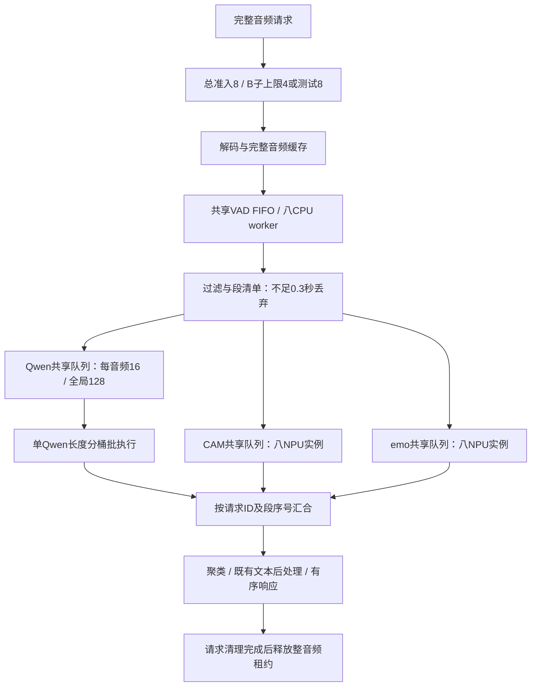

# Design

## Context

动机见 proposal.md。权威开发目录为 `xjtu910b7:/home/zhangs/asr_nvidia`，起始提交 `2c59132a0a14a08188b2fe1c3fa07eeb9249da4a`。前次迁移已归档，本变更独立规划；当前仅生成规划文件。

现有单Qwen客户端每次租用一个runtime，processor/generate/decode只处理一个段；`request_concurrency`增大只增加排队。段任务持有同一个信号量直到Qwen/CAM++/emo全部完成，慢增强可能间接饿住Qwen。固定VAD池已有完整音频FIFO、空闲worker即时接力能力，应保留并验证。

旧八完整音频g1测试约3210次Qwen调用累计4756秒，某请求Qwen排队约67分钟，是诊断线索；调用包络包含CPU特征、传输、生成和同步，并非纯NPU核耗时。旧g2仍单份、单段物理执行，不能证明批处理或多副本无效。单Qwen历史加载增量allocated约3900MiB、reserved约4268MiB，后者包含前者；不等于128段峰值。原始证据见 `docs/npu-910b-migration-validation-20261117.md` 及其引用附件。

## Goals / Non-Goals

**Goals:**

- 优先单Qwen，在物理NPU:7用真实批执行提高吞吐；使多条完整音频持续供给，每音频16、全局128逻辑段在途。
- 分离准入、VAD租约、各模型阶段名额、待执行容量和汇合缓存，运行、排队与等待原因可观测。
- 用同一工作量的1/2/4/8完整音频并发、同源A/B及420秒诊断闭环决定配置。

**Non-Goals:**

- 不改变v3字段、错误码、时间轴、`gpu_time_ms`口径，不恢复旧路由；本轮不做teacher/student规则优化。
- 不改变FSMN实际参数绑定、权重或模型分段算法，不做格式转换、依赖升级、vLLM生产替换；这些候选若需要改变架构须先另行修订规划。
- 不启动多完整服务进程；`instance_count=1`。实际Docker构建和上线后置。

## Decisions

### 1. 单Qwen真实批执行优先

原生processor接受音频列表和相应语言列表，将独立段组成物理批次，校验左padding、有效mask、整数/布尔dtype及逐样本解码归属。批大小与逻辑在途上限独立，不能并发调用同一可写runtime的多次generate。先采用已具备基础支持的原生列表批执行；不能把128个协程或HF通用continuous batching接口直接当作Qwen音频/NPU已支持。

调度采用跨音频公平轮转的共享就绪队列和长度分桶；等待上限到期、输入预算不足或尾批时立即发出当前可执行批次。只有2条音频时最多32个Qwen逻辑段就绪，应及时处理，不凑128。8条各16个就绪段用于验证实际128批容量。记录最大批数、实发批分布和预算拆批原因；若128失败或拆成小批，不声明实际128通过。

先测实际batch=1/8/16/32/64/128，混合真实长度与提示；目标128仍须验证。纯Qwen128通过后，必须在八CAM+八emo已加载且实际工作的B配置中验证128，即使128未入选最快档；不同资源条件容量不能互相代替。最快档可能小于128，报告吞吐/P95/质量/共享HBM后选择交付批上限，不能把128固定等同于最优。单份128若失败，先定位输入、HBM、算子或调度原因；有容量/效率证据后再测试2/4/8份。多份共享待执行队列、空闲优先，结合估计帧数/生成量减少长短段不均；不把一整条音频永久绑定某份实例。

### 2. 阶段独立供给与有界汇合

各分支只在请求需要且时长规则适用时运行。Qwen名额从该段进入Qwen在途窗口算起，包含对应等待/批执行/必要收尾，不包含尚未准入Qwen的全部待处理段；Qwen完成后即释放，与CAM/emo最终join分离。CAM/emo各自完成即归还实例，不等待完整音频响应。VAD完成即归还worker；整音频准入租约仍持有至所有已启动工作及请求清理完成。

使用有界段生产、有限执行线程与按请求/段标识的汇合缓存，避免对数千段一次创建无限future或复制多份完整PCM。增强队列满时可有明确、可统计的反压；在预算未满时，等待增强模型不能占住已完成Qwen的名额。调度不得持有一个模型实例再等待另一个模型实例，避免循环等待。最终业务进度仍在该段所有所需分支结束后推进，内部另报分支进度。

### 3. 模型实例、预取深度、实际批大小分开配置

| 配置层 | 拟定字段/来源 | 语义与验证目标 |
| --- | --- | --- |
| 完整音频 | 既有 `audio_concurrency=8`、`audio_spk_emo_concurrency=4` | A+B≤8且B≤子上限，B8为独立profile |
| Qwen实例 | `local_instance_count=1`、`local_device="npu:7"` | 每份权重独立；不是服务进程数 |
| Qwen在途 | `segment_concurrency=16`、`request_concurrency=128` | 单音频/全局逻辑段窗口 |
| Qwen批执行 | 新 `max_inference_batch_size=128` 候选 | 物理批上限；交付值按实测选定 |
| Qwen批预算 | 新 `batch_wait_timeout_ms`、`max_batch_audio_frames`、`max_batch_tokens` | 有限等待、padding后特征及token预算；文档写清单位/计算口径 |
| VAD实例 | 既有 `[vad].vad_device` 八个 `cpu` | 八份健康预热worker，各处理一条完整音频 |
| CAM/emo实例 | 既有设备数组，各八个 `npu:7` | 健康实例决定实际容量；保持FP32 |
| 增强预取 | 新 `[model_device_pool].speech_campplus_prefetch_queue_depth`、`emotion2vec_prefetch_queue_depth` | **每健康实例等待任务数**，不含一个运行任务；0代表不预取而非无限队列 |
| 增强计算批 | 新 `speech_campplus_batch_size`、`emotion2vec_batch_size`，本轮为1 | 保留显式校验；未实现并验收批适配前大于1必须报错，不能无效配置 |
| 汇合内存 | 新 `[qwen_asr].pending_segment_limit`、`pending_audio_bytes_limit` | 有界段结果/PCM预算，反压原因可定位 |
| 测试闸门 | 测试配置/脚本 `diagnostic_wall_timeout_s=420` | 测试诊断线，与现有Qwen单次timeout和业务HTTP超时独立 |

参数名为本设计拟定；实施若调整命名须同步设计、配置契约与文档，保持以上语义。所有可调字段须有类型、有限范围、默认值、重启说明和校验测试；预算与等待窗口从小规模标定取得，不能凭空宣布已验收。prefetch深度比较0/1和5，5仅候选。每实例等待5且8实例代表40个等待+最多8个运行，不是实际batch5。共享队列或可回收预取缓冲只统计一次，尚未执行的任务可重新分派；不得私有队列绑死长任务使其它实例空闲。

### 4. 短段与过滤采用明确的新测试配置

本轮固定 `[vad]`：`min_segment_duration_s=0.3`，`vad_snr_thres_filter_enabled=false`、`vad_decibel_thres_filter_enabled=false`、`vad_low_volume_filter_enabled=false`，`vad_decibel_thres=-100`、`after_start=-1`、`before_end=-1`。三个enable关闭才关闭服务能量规则；-1/-1表示不限制位置，不能解释为关闭开关。保留其它兼容参数及FSMN实际构造，报告声明、传递、模型实读和服务后过滤四层证据。所有新对照使用同配置，不能与旧开过滤的80分钟结果计算严格加速比。

| 段有效时长 | Qwen | CAM（请求时） | emo（请求时） |
| --- | --- | --- | --- |
| <0.3秒 | 不提交 | 不提交 | 不提交；无响应段 |
| [0.3,1)秒 | 提交 | 实际推理并参与聚类 | 不推理，返回“平淡” |
| [1,10]秒 | 提交 | 实际推理并参与聚类 | 实际推理 |
| >10秒 | 提交 | 按既有输入支持与失败契约处理 | 不推理，返回“平淡” |

CAM修改必须同时覆盖推理入口、聚类embedding筛选、短段就近标签规则，避免得到短段embedding又丢弃；保留相似度阈值及原标签映射。时长比较以原始有效采样数为准，不以响应两位小数时间计算；299/300/301ms、999/1000/1001ms及10秒边界均测试。`showSpk`才是字段名；本轮`showRoleIdentify=false`，不能借此移除已有可选能力。

### 5. 420秒触发诊断后再推进

每条完整请求以客户端调用/上传开始至完整读响应为端到端主计时，并保留服务接收、准入、各阶段时间戳；客户端、服务端各用自己的单调钟算时长，跨进程关联用ID和UTC，不相减不同单调时钟。P50或P95 **超过420秒**、任一在途请求墙钟超过420秒时，watchdog不等最终统计，至迟下一采样周期（默认1秒）触发；阶段长时间无进展也应提前采样告警。

流程：停止新增负载→立即落盘当前请求/各队列/各实例/真实批/阶段进度及资源快照→在有界诊断窗口内补采必要证据→取消未开始任务、等待已启动owned工作安全收尾→关闭owned服务与worker/端口→输出卡点判断及下一次小规模验证。诊断窗口、收尾期限有界且配置化；超时仅可按登记的PID和创建时间回收本轮资源，保留异常结论，不操作既有服务。

触发后的轮次标记`diagnostic_aborted`，未完成、失败与成功子集分别列示，不能以快请求子集P95宣称通过。420秒是排障门槛，不是自动返回的新业务错误、不替换单Qwen120秒调用超时，也不承诺整批8文件总耗时≤7分钟。长请求有持续进展仍触发检查，不能因此豁免；触发后不得原样无限重跑。

### 6. 测量先拆包络，再决定优化位置

记录上传/解码、准入、VAD等候/检测/过滤、纯PCM切片、各模型入队/取任务/执行/收尾、Qwen CPU特征/批等待/传输/generate/解码/同步、聚类/ITN/响应。将当前包含信号量等待的`cut_sum_ms`与纯切片计时区分，保留旧遥测语义并另加新指标。记录队列非空时实例交接间隙、分桶等待、预算反压、实际帧数、padding及生成token量，避免只看到一个`call_ms`。

`generate`内部prefill/decode可通过限定的小规模profiler补证，不能将普通墙钟包络称纯核耗时。批执行耗时保留批ID共享包络，不能为每成员重复累计后冒充设备总忙时；并行阶段总和不能冒充关键路径。设备级synchronize可能使同卡分支互相等待；先测同步范围和执行流，保持必要生命周期同步，只有经事件/流归属及取消测试证明安全后才优化同步。

详细样本、阶段、故障及性能矩阵见 [test-plan.md](test-plan.md)。

## Risks / Trade-offs

- [长短段padding与生成长尾] → 长度分桶、帧/token预算和有限等待；保留真实长度分布，不只用短片证明128。
- [共享NPU竞争与额外实例占用] → 按用户要求CAM/emo各八NPU实例起测，分开记录既有服务和本项目HBM，不能用副本数代替硬件并行度；有实测瓶颈再调整。
- [128批OOM或算子失败] → 有界升档、失败留证、释放owned资源；先诊断单Qwen，再条件评估多副本；未通过128必须明确报告，不能静默拆批冒充通过。
- [短CAM嵌入不稳] → 记录0.3～1秒embedding、聚类和role差异，采用同权重FP32参考；不擅自恢复不足1秒跳过规则。
- [慢分支内存积压] → 独立阶段配额和有界结果缓存；明确反压，不承诺无限期无阻塞。
- [八文件小样本和冷启动偏差] → 冷/暖分开、最终候选重复轮次、逐文件配对，明确N及分位数算法；无人工真值不宣称准确率提升。

## Migration Plan

1. apply阶段先完成watchdog、遥测及CPU调度/契约测试，再做NPU模型性能试验，避免先盲跑长音频。
2. 固定原始模型/依赖/数据清单，独立测试配置先验证单Qwen批曲线和八份增强池，按诊断结果决定是否多份回退；保留已验收旧配置快照用于回退。
3. 完成同源配对的1/2/4/8完整音频及异常/取消/收尾，记录未完成和容量失败；仅对通过质量/稳定性验证的最快档更新交付配置及文档。
4. 回退通过恢复配置/对应实现提交完成，不改写Git历史、不删除日志/权重；测试服务关闭，既有共享服务不重启。
5. 实施与报告中文Conventional Commits提交推送；全部必需验收完成后单独同步主规格并提交归档。本次propose保持所有实施任务未勾选。

## Open Questions

- 单Qwen实际128容量及最快批大小、帧/token预算、等待窗口和预取深度由实验回答；若64更快，报告两者容量与性能证据后按最快合格档选值，不将128作为预设最佳值。
- 尚无用户指定的绝对整批完成时长目标；420秒排障规则立即生效，最终性能报告给出各档实测上限与限制，不用“未指定SLA”绕过诊断。
