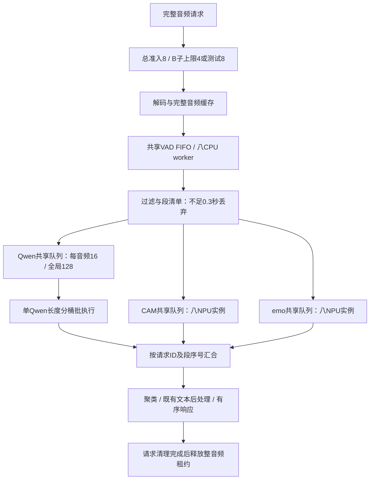

# Design

## Context

动机见 proposal.md。权威开发目录为 `xjtu910b7:/home/zhangs/asr_nvidia`，起始提交 `2c59132a0a14a08188b2fe1c3fa07eeb9249da4a`。前次迁移已归档，本变更现处apply；实施与实机验收进度以tasks及验证报告为准。

现有单Qwen客户端每次租用一个runtime，processor/generate/decode只处理一个段；`request_concurrency`增大只增加排队。段任务持有同一个信号量直到Qwen/CAM++/emo全部完成，慢增强可能间接饿住Qwen。固定VAD池已有完整音频FIFO、空闲worker即时接力能力，应保留并验证。

旧八完整音频g1测试约3210次Qwen调用累计4756秒，某请求Qwen排队约67分钟，是诊断线索；调用包络包含CPU特征、传输、生成和同步，并非纯NPU核耗时。旧g2仍单份、单段物理执行，不能证明批处理或多副本无效。单Qwen历史加载增量allocated约3900MiB、reserved约4268MiB，后者包含前者；不等于128段峰值。原始证据见 `docs/npu-910b-migration-validation-20261117.md` 及其引用附件。

## Goals / Non-Goals

**Goals:**

- 优先单Qwen，在物理NPU:7用真实批执行提高吞吐；使多条完整音频持续供给，每音频16、全局128逻辑段在途。
- 分离准入、VAD租约、各模型阶段名额、待执行容量和汇合缓存，运行、排队与等待原因可观测。
- 用同一工作量的1/2/4/8完整音频并发、同源A/B及420秒诊断闭环决定配置。

**Non-Goals:**

- 不改变v3字段、错误码、时间轴、`gpu_time_ms`口径，不恢复旧路由；本轮不做teacher/student规则优化。
- 不改变FSMN实际参数绑定、权重或模型分段算法，不做格式转换、依赖升级、vLLM生产替换；这些候选若需要改变架构须先另行修订规划。
- 不启动多完整服务进程；`instance_count=1`。实际Docker构建和上线后置。

## Decisions

### 1. 单Qwen真实批执行优先

原生processor接受音频列表和相应语言列表，将独立段组成物理批次，校验左padding、有效mask、整数/布尔dtype及逐样本解码归属。批大小与逻辑在途上限独立，不能并发调用同一可写runtime的多次generate。先采用已具备基础支持的原生列表批执行；不能把128个协程或HF通用continuous batching接口直接当作Qwen音频/NPU已支持。

调度采用跨音频公平轮转的共享就绪队列和长度分桶；等待上限到期、输入预算不足或尾批时立即发出当前可执行批次。只有2条音频时最多32个Qwen逻辑段就绪，应及时处理，不凑128。8条各16个就绪段用于验证实际128批容量。记录最大批数、实发批分布和预算拆批原因；若128失败或拆成小批，不声明实际128通过。

先测实际batch=1/8/16/32/64/128，混合真实长度与提示；目标128仍须验证。纯Qwen128通过后，必须在八CAM+八emo已加载且实际工作的B配置中验证128，即使128未入选最快档；不同资源条件容量不能互相代替。最快档可能小于128，报告吞吐/P95/质量/共享HBM后选择交付批上限，不能把128固定等同于最优。单份128若失败，先定位输入、HBM、算子或调度原因；有容量/效率证据后再测试2/4/8份。多份共享待执行队列、空闲优先，结合估计帧数/生成量减少长短段不均；不把一整条音频永久绑定某份实例。

### 2. 阶段独立供给与有界汇合

各分支只在请求需要且时长规则适用时运行。Qwen名额从该段进入Qwen在途窗口算起，包含对应等待/批执行/必要收尾，不包含尚未准入Qwen的全部待处理段；Qwen完成后即释放，与CAM/emo最终join分离。CAM/emo各自完成即归还实例，不等待完整音频响应。VAD完成即归还worker；整音频准入租约仍持有至所有已启动工作及请求清理完成。

使用有界段生产、有限执行线程与按请求/段标识的汇合缓存，避免对数千段一次创建无限future或复制多份完整PCM。增强队列满时可有明确、可统计的反压；在预算未满时，等待增强模型不能占住已完成Qwen的名额。调度不得持有一个模型实例再等待另一个模型实例，避免循环等待。最终业务进度仍在该段所有所需分支结束后推进，内部另报分支进度。

### 3. 模型实例、预取深度、实际批大小分开配置

| 配置层 | 拟定字段/来源 | 语义与验证目标 |
| --- | --- | --- |
| 完整音频 | 既有 `audio_concurrency=8`、`audio_spk_emo_concurrency=4` | A+B≤8且B≤子上限，B8为独立profile |
| Qwen实例 | `local_instance_count=1`、`local_device="npu:7"` | 每份权重独立；不是服务进程数 |
| Qwen在途 | `segment_concurrency=16`、`request_concurrency=128` | 单音频/全局逻辑段窗口 |
| Qwen批执行 | 新 `max_inference_batch_size=128` 候选 | 物理批上限；交付值按实测选定 |
| Qwen批预算 | 新 `batch_wait_timeout_ms`、`max_batch_audio_frames`、`max_batch_tokens` | 有限等待、padding后特征及token预算；文档写清单位/计算口径 |
| Qwen长度兼容 | 新 `batch_max_duration_ratio`，缺省4.0，候选32.0 | 有效STFT帧数最长/最短比，有限数1～64；与批上限及实例数分开 |
| VAD实例 | 既有 `[vad].vad_device` 八个 `cpu` | 八份健康预热worker，各处理一条完整音频 |
| CAM/emo实例 | 既有设备数组，各八个 `npu:7` | 健康实例决定实际容量；保持FP32 |
| 增强预取 | 新 `[model_device_pool].speech_campplus_prefetch_queue_depth`、`emotion2vec_prefetch_queue_depth` | **每健康实例等待任务数**，不含一个运行任务；0代表不预取而非无限队列 |
| 增强计算批 | 新 `speech_campplus_batch_size`、`emotion2vec_batch_size`，本轮为1 | 保留显式校验；未实现并验收批适配前大于1必须报错，不能无效配置 |
| 汇合内存 | 新 `[qwen_asr].pending_segment_limit`、`pending_audio_bytes_limit` | 有界段结果/PCM预算，反压原因可定位 |
| 测试闸门 | 测试配置/脚本 `diagnostic_wall_timeout_s=420` | 测试诊断线，与现有Qwen单次timeout和业务HTTP超时独立 |

参数名为本设计拟定；实施若调整命名须同步设计、配置契约与文档，保持以上语义。所有可调字段须有类型、有限范围、默认值、重启说明和校验测试；预算与等待窗口从小规模标定取得，不能凭空宣布已验收。prefetch深度比较0/1和5，5仅候选。每实例等待5且8实例代表40个等待+最多8个运行，不是实际batch5。共享队列或可回收预取缓冲只统计一次，尚未执行的任务可重新分派；不得私有队列绑死长任务使其它实例空闲。

### 4. 短段与过滤采用明确的新测试配置

本轮固定 `[vad]`：`min_segment_duration_s=0.3`，`vad_snr_thres_filter_enabled=false`、`vad_decibel_thres_filter_enabled=false`、`vad_low_volume_filter_enabled=false`，`vad_decibel_thres=-100`、`after_start=-1`、`before_end=-1`。三个enable关闭才关闭服务能量规则；-1/-1表示不限制位置，不能解释为关闭开关。保留其它兼容参数及FSMN实际构造，报告声明、传递、模型实读和服务后过滤四层证据。所有新对照使用同配置，不能与旧开过滤的80分钟结果计算严格加速比。

| 段有效时长 | Qwen | CAM（请求时） | emo（请求时） |
| --- | --- | --- | --- |
| <0.3秒 | 不提交 | 不提交 | 不提交；无响应段 |
| [0.3,1)秒 | 提交 | 实际推理并参与聚类 | 不推理，返回“平淡” |
| [1,10]秒 | 提交 | 实际推理并参与聚类 | 实际推理 |
| >10秒 | 提交 | 按既有输入支持与失败契约处理 | 不推理，返回“平淡” |

CAM修改必须同时覆盖推理入口、聚类embedding筛选、短段就近标签规则，避免得到短段embedding又丢弃；保留相似度阈值及原标签映射。时长比较以原始有效采样数为准，不以响应两位小数时间计算；299/300/301ms、999/1000/1001ms及10秒边界均测试。`showSpk`才是字段名；本轮`showRoleIdentify=false`，不能借此移除已有可选能力。

### 5. 420秒触发诊断后再推进

每条完整请求以客户端调用/上传开始至完整读响应为端到端主计时，并保留服务接收、准入、各阶段时间戳；客户端、服务端各用自己的单调钟算时长，跨进程关联用ID和UTC，不相减不同单调时钟。P50或P95 **超过420秒**、任一在途请求墙钟超过420秒时，watchdog不等最终统计，至迟下一采样周期（默认1秒）触发；阶段长时间无进展也应提前采样告警。

流程：停止新增负载→立即落盘当前请求/各队列/各实例/真实批/阶段进度及资源快照→在有界诊断窗口内补采必要证据→取消未开始任务、等待已启动owned工作安全收尾→关闭owned服务与worker/端口→输出卡点判断及下一次小规模验证。诊断窗口、收尾期限有界且配置化；超时仅可按登记的PID和创建时间回收本轮资源，保留异常结论，不操作既有服务。

触发后的轮次标记`diagnostic_aborted`，未完成、失败与成功子集分别列示，不能以快请求子集P95宣称通过。420秒是排障门槛，不是自动返回的新业务错误、不替换单Qwen120秒调用超时，也不承诺整批8文件总耗时≤7分钟。长请求有持续进展仍触发检查，不能因此豁免；触发后不得原样无限重跑。

### 6. 测量先拆包络，再决定优化位置

记录上传/解码、准入、VAD等候/检测/过滤、纯PCM切片、各模型入队/取任务/执行/收尾、Qwen CPU特征/批等待/传输/generate/解码/同步、聚类/ITN/响应。将当前包含信号量等待的`cut_sum_ms`与纯切片计时区分，保留旧遥测语义并另加新指标。记录队列非空时实例交接间隙、分桶等待、预算反压、实际帧数、padding及生成token量，避免只看到一个`call_ms`。

`generate`内部prefill/decode可通过限定的小规模profiler补证，不能将普通墙钟包络称纯核耗时。批执行耗时保留批ID共享包络，不能为每成员重复累计后冒充设备总忙时；并行阶段总和不能冒充关键路径。设备级synchronize可能使同卡分支互相等待；先测同步范围和执行流，保持必要生命周期同步，只有经事件/流归属及取消测试证明安全后才优化同步。

详细样本、阶段、故障及性能矩阵见 [test-plan.md](test-plan.md)。

## Risks / Trade-offs

- [长短段padding与生成长尾] → 长度分桶、帧/token预算和有限等待；保留真实长度分布，不只用短片证明128。
- [共享NPU竞争与额外实例占用] → 按用户要求CAM/emo各八NPU实例起测，分开记录既有服务和本项目HBM，不能用副本数代替硬件并行度；有实测瓶颈再调整。
- [128批OOM或算子失败] → 有界升档、失败留证、释放owned资源；先诊断单Qwen，再条件评估多副本；未通过128必须明确报告，不能静默拆批冒充通过。
- [短CAM嵌入不稳] → 记录0.3～1秒embedding、聚类和role差异，采用同权重FP32参考；不擅自恢复不足1秒跳过规则。
- [慢分支内存积压] → 独立阶段配额和有界结果缓存；明确反压，不承诺无限期无阻塞。
- [八文件小样本和冷启动偏差] → 冷/暖分开、最终候选重复轮次、逐文件配对，明确N及分位数算法；无人工真值不宣称准确率提升。

## Migration Plan

1. apply阶段先完成watchdog、遥测及CPU调度/契约测试，再做NPU模型性能试验，避免先盲跑长音频。
2. 固定原始模型/依赖/数据清单，独立测试配置先验证单Qwen批曲线和八份增强池，按诊断结果决定是否多份回退；保留已验收旧配置快照用于回退。
3. 完成同源配对的1/2/4/8完整音频及异常/取消/收尾，记录未完成和容量失败；仅对通过质量/稳定性验证的最快档更新交付配置及文档。
4. 回退通过恢复配置/对应实现提交完成，不改写Git历史、不删除日志/权重；测试服务关闭，既有共享服务不重启。
5. 实施与报告中文Conventional Commits提交推送；全部必需验收完成后单独同步主规格并提交归档。本次propose保持所有实施任务未勾选。

## Open Questions

- 单Qwen实际128容量及最快批大小、帧/token预算、等待窗口和预取深度由实验回答；若64更快，报告两者容量与性能证据后按最快合格档选值，不将128作为预设最佳值。
- 尚无用户指定的绝对整批完成时长目标；420秒排障规则立即生效，最终性能报告给出各档实测上限与限制，不用“未指定SLA”绕过诊断。

## 实施发现与v2修正决策（2026-11-18）

### 独立前端替代waveform批补齐

初始原生列表processor在同128段上与scalar产生27段稳定文本差异。纯CPU FP32对照发现124/128成员有效features不完全相同，其中121个成员在大于1e-6口径下的差异局限最后3有效帧，最大abs约0.5413；三成员有效mask多1帧，去padding的text IDs全部相同。代码路径先对waveform批补齐再STFT，单段reflect末尾和批内零尾不同；mask末帧处理还依赖整批补齐后的样本长度。25个文本差异伴随前端差异，另2个在有效features/mask/IDs完全一致时仍改变文本，因此不能把全部变化归因于前端。scalar和批各自重复稳定也不证明哪个文本更准确。证据见`docs/npu-throughput-20261118/qwen-quality-initial.json`。

决定在项目runtime内逐成员调用原processor，并在FP32 guard下显式collation：有效text左padding，完整single features及mask只增加右padding，保留原single已有的STFT尾部与补齐；batch1保留原dict。只接受锁定四字段的明确shape和一致dtype，未知输入失败，不改安装环境、权重或BF16计算策略。CPU128真实段探针九项均128/128精确等价，记录在`qwen-frontend-equivalence-v2.json`；此证据尚不能代替新的NPU文本与性能测量。

### 帧预算与时长比

实际前端属性`n_fft=400`、`hop_length=160`、`min_length=8000`、`n_window=50`。原single有效帧估计为`floor(max(samples,8000)/160)`，完整特征轴再补至100帧倍数，批帧预算使用最长完整特征轴乘成员数。token预算继续明确为音频8:1近似加生成上限及256提示预留，真实shape另外保存；属性变化需要重新核验，不能把旧的`ceil(samples/160)`当实际完整特征轴。

新增`batch_max_duration_ratio`，有限数1～64、缺省4.0，32.0为独立候选；它约束有效STFT帧最大/最小比，包含原前端最短0.5秒处理，不改业务段时长。配置、constructor、模板及文档须一致校验，候选增大不能代替帧/token预算。

### 队首阻塞与公平性

同一mixed128在全就绪的纯CPU影子实验中，旧仅看队首的分桶拆为12批；只改变长度顺序而保留请求/段归属可降为3批。决定在每请求有界队列中扫描兼容尾成员，按请求轮转，不永久绑死不兼容队首。另一持续补给实验显示，仅轮转成员仍可能让旧长head在64批内一直得不到锚定；每批先取全局最老等待队首作为锚点后，该旧head在第5批获得执行机会。公平性要求全局最老head锚定，不以新短任务持续替换锚点。

以上属于本change内对独立段语义、预算和公平性要求的实现修正；不修改v3响应字段、时间轴、错误码或权重。NPU候选、真实八增强池、1/2/4/8完整音频和420秒诊断验收仍依tasks逐项执行，未完成前不提升当前安全默认或归档。

### 有限生产者的批完成补位窗口

完整音频实际供给每音频只有16个在途段，和微基准一次预填128段不同。初始队列11段执行时其它5段进入等待，原实现仅按旧尾的入队时间计算10ms；物理批完成后旧尾deadline早已过期，会在消费者释放名额、完成下一次PCM切片之前立即派发5段，之后可能持续11/5交替。该现象属于补位时序问题，不能把全局128上限当成实发128。

修正为每个worker保留自身最近物理批收尾时刻；下一批有限等待deadline取“最早等待成员入队+batch_wait_timeout_ms”和“本worker上批收尾+同一等待窗口”较晚者。deadline固定，不因新任务通知或其他副本完成而延长；已满批立即执行，close唤醒后跳过补位等待，原空闲首批仍遵守入队窗口。等待到期即派发现有32/64或更少成员，不等待凑128。

纯CPU、生产模式event loop（debug=False）的16个有限生产者持续512段、每次完成后模拟1～3ms异步切片实验，修正前重复11/5，修正后初始11、稳定31批16、末尾5；在途峰值始终16。另以连续新arrival和close唤醒覆盖固定deadline与关闭行为。证据为`/tmp/asr-throughput-20261118-xvior99k/dynamic-refill-cpu.json`；这是CPU调度回归，真实NPU动态供给和完整音频仍须复验，不据此宣称NPU吞吐已通过。

### 实施审查补正：预算、重试与实际采样数

完整链路及独立CPU反例暴露的实现边界不通过新增例外豁免：每音频固定32个全分支join worker会早于全局预算耗尽卡住供给，改为每音频元worker上限由pending_segment_limit（候选256）确定；8个完整音频最多2048个有限元任务，实际持有PCM/启动分支的活动段仍由全局256段/256MiB估算预算约束，二者分别说明，不能把元任务数当作模型在途数。增强等待只有在真实段/字节预算耗尽时反压；已完成Qwen名额仍立即归还。

重试每attempt开始重滤已取消成员，不能把首次active列表直接复用到下一attempt。每次实际attempt保存输入及有效成员、timing和失败状态；summary保持最后实际attempt语义，全部成员backoff取消时另记跳过、不新建虚假size0物理批，也不把旧valid_indices套到空成员列表。输出prefix坏的成员单独4012，不连带其它请求的合法输出；整体batch_decode/基数错误仍按整次物理调用失败处理。

结果中的异常只保留独立浅副本的类型/code/message，去除traceback/cause/context，不清理仍活跃原协程frame；避免错误列表滞留已归还预算的PCM。CPU弱引用/预算恢复测试验证这一边界。

正式numpy/tensor/ms及内存WAV裁剪统一将VAD秒端点round到采样格再clamp，不调整对外bg/ed、不padding；0.3秒与emo[1,10]门限以裁剪后的实际PCM样本数判定，EOF截短不足0.3秒在三个模型之前丢弃。旧FFmpeg兼容通道不改为逐段读完整大文件。曲线工具复用同一端点函数；此修正改变两份128清单各4段WAV字节，旧参考不伪装为最终同输入参考，标量及入选批需重新核验。

## 单Qwen模型进程隔离决策（实施v5）

同卡的原生thread模式保持设备级同步时，Qwen与CAM/emo的CPU前端、Python执行及进程级精度guard存在干扰。仅分流同步的16段实验中位耗时从5.29秒到4.99秒，收益较小，且还需额外冷形状及取消归属验证，因此本轮不采用stream同步改写。保留原torch_npu推理、FP32增强、BF16 Qwen和必要设备同步。

采用可配置`execution_mode = "thread" / "process"`的单模型进程候选：HTTP/完整音频调度仍为一个服务进程；process模式每个既有runtime实例仅在spawn子进程中持有一份同HF Qwen模型，不在父进程再加载第二份。父进程保留VAD协调、CAM/emo和批调度，按物理批通过有界请求协议发送独立PCM、提示与成员ID。当前候选`local_instance_count=1`，不是增加副本；设备直接继承配置，宿主npu:7与单卡容器逻辑npu:0分别校验。不得静默换引擎、降精度、自动重启或CPU回退。

配对实验在相同原生HF runtime、128成员真实批、八CAM/八emo常驻并实际执行下，thread纯Qwen三轮5.216/5.234/5.113秒、B三轮16.910/16.873/16.899秒；process纯Qwen4.999/4.859/4.904秒、B10.469/11.389/10.658秒。16段B中位5.309降至3.250秒。全部逐ID Qwen原始/解析输出以及CAM192维和emo实际7类输出对照通过（数值容差1e-5，分类标签不变），全部owned进程正常关闭。证据目录`qwen-process-pair-v5-16`、`qwen-process-pair-v5-128`；组件增益不替代整音频矩阵或声明全部等待都源自GIL。

协议READY保存worker PID/创建时间、实际模块来源SHA、模型目录/设备/dtype；每RPC带调用和成员标识，失败保留原错误码分层。状态查询仅读取缓存与OS身份，不触发懒启动或向忙worker发送RPC。子进程allocator/加载增量、当次物理调用峰值、父进程allocator及各进程RSS分别标注，不能用父进程零值冒充模型资源，也不能相加不同时刻峰值。现有256MiB仅约束主流水线逻辑PCM，IPC副本和worker RSS另报。

请求取消或120秒单次推理timeout不意味着强杀worker；已启动物理批须保留所有权直到DONE/读取完成或确认该owned worker死亡，部分成员取消不影响其它成员。仅显式服务关闭启用独立有限`process_shutdown_grace_s`；超期按注册PID和创建时间终止并join该worker，使RPC读取结束，再归还真实资源。强制回收必须令关闭/验收失败并保留证据，不作正常ACK。关闭看护在服务shutdown入口启动，避免先关闭增强池时永远轮不到Qwen收尾。保护构建须包含新core worker，并实际spawn验证CPU协议和NPU推理/取消/关闭，旧33模块结果不代替新保护版本。

### 多文件供给公平性修正

真实API CPU反例显示，若先获取全局256 PCM预算再等每音频16名额，首个完成VAD的文件可能占满全部PCM，后七文件虽已VAD-ready仍无法供给，Qwen仅收到16段、空余112个逻辑名额。改为先获取每音频/全局Qwen逻辑credit，再申请PCM并裁剪；同一个幂等credit交给Qwen分支，实际完成即归还，不等增强join。裁剪失败、EOF不足0.3秒、客户端错误及取消由finally兜底。八文件各16可共同供给128；慢增强继续积累到真实256段/字节预算时才反压。预留credit但还在等待PCM的段不是实际执行成员，遥测必须分列，不能据global128已占用声称真实batch128。

## 实机观测迟滞与状态采样解耦（实施v6）

真实4.1秒请求在0.6～1.2秒完成，而`/get_status`的NPU/procfs采样约2秒；两分钟真实片段的4B测试已观测到活动4/B4且第五B返回4017，但额外诊断GET因原工具5秒读取超时而使该轮中止。原始两轮均保留为未通过，不补造总8的证据；420秒总诊断线不变。仅把工具读取延长和非门槛快照标unknown不足以保证后续实时观测，需要将重资源采样与实时计数分开。

每个app/lifespan拥有一个按需TTL singleflight资源采样器；初始化不采样，无状态查询时不永久轮询NPU。GET只在到期且无在途collector时启动后台采样，并立即用最后完整快照或明确unknown组装响应，实时准入/VAD/Qwen/增强/段进度仍由主事件循环读取。附带资源age、采样起止/耗时、in_progress及last_error，不能将旧资源值冒充当前值。采样间隔配置化并校验有限范围；不改变v3字段、错误码或任何推理数值路径。

shutdown先禁止新采样，等待已启动collector线程/子进程实际收尾；重复取消共享同一个close任务，不能丢失后台工作。不同app/loop不共享任务。collector只读取OS资源及出生身份，不能跨线程读取可变模型调度状态；主循环按Qwen缓存的worker PID/start_ticks/创建时间验证HBM归属，分列父进程、本项目Qwen与外部/未验证进程。父进程零allocator不能替代worker值，资源缓存与模型worker缓存各自保留时间/范围。

此为全流程可观测性的必要修正，任务新增2.8；v5的34so/全量CPU与模型NPU取消、稳态及通信故障负例原始证据保留。v6仅对实际改动模块选编，须重新验证CPU、实际状态延迟、owned关闭和同源完整矩阵，不能以v5全套SHA冒称新状态实现已验证。

## CAM-only模型进程候选决策（实施v9，待正式验收）

完整8B预检在421.238秒触发诊断，全部256段PCM名额被未完成CAM占据；Qwen生成本身亦在关键路径。流策略仅小幅描述性变化，串行CAM没有加速，均未生产采用。细分测量将CAM主要耗时范围收窄至原network.forward主机包络，不能单独归为GIL或纯设备核时。

保持单Qwen HF/BF16进程、八CPU VAD及八父进程FP32 emo，独立实验将八个同FP32 CAM副本分别置于owned spawn进程。fresh128成对三稳整体10.335/9.966/10.089秒降为5.186/5.056/5.185秒；CAM调用跨度约10秒降至1.3～1.4秒，同钟尾部变为Qwen。四轮Qwen原始/解析文本、CAM192值、emo7类及标签均精确一致，所有8worker实际参数/浮点buffer均FP32/NPU7，全部正常退出。原始证据见`cam-process128-v8c-{independent-audit,tail-audit}.json`；这不证明全4369动态段已达标。

正式候选增加`model_device_pool.speech_campplus_execution_mode = "thread" | "process"`，兼容缺省thread；启动timeout候选60秒、显式关闭grace候选30秒，按当前每worker约16秒启动与正常数秒收尾的实测保留余量，完整类型/范围以实现/配置契约测试为准。实例数仍仅来自设备数组，进程模式仅支持合法NPU设备，宿主7和容器逻辑0都需覆盖。仍为一个HTTP服务，不增加完整服务副本，不改模型格式、FP32精度、聚类、情绪映射或Qwen模型数量。最终缺省只有完整矩阵及保护版本通过后才选择。

正式runner继承InferenceRunner，输入保持原CPU单声道16k浮点波形，结果为原CPU float32 Tensor[1,192]；IPC发送有身份的float32 PCM与192个float32值（768字节），不得把实验numpy返回类型直接用于正式聚类。READY校验worker出生/launch、实际入口与factory py/so SHA、模型资产、实际参数/浮点buffer设备与精度；DONE核RPC/PCM及有限结果，不允许混段或假冒父NPU流。状态只读缓存和OS，区分parent/各worker/共享卡资源与最后RPC allocator/峰值范围，IPC额外副本与RSS另计。

模型池在等待loading或运行lease前先发布process closing并启动独立grace，覆盖尚在出生的owned实例；不持RPC读锁执行abort，不因调用者取消提前归还。普通取消等待实际DONE，明确关闭超grace只终止PID/出生身份仍吻合的owned子进程，确认死亡后才归还；未确认死亡继续隔离，强制、坏ACK、非0退出与历史异常不得被重复close洗为正常。保留原池FIFO/预取/有界预算及失败隔离，未请求CAM时不spawn；emo保持原父进程runner。

正式源码/保护版本必须重新验证CPU Tensor契约、short CAM参与聚类、八模型健康与真实批128、预取0/1/5、取消/错误/重复关闭以及资源归属，之后才恢复最终同八文件1/2/4/8与混合矩阵。原型的约290秒launcher时间含启动与关闭，不当作5秒稳态推理时间；冷启动另列。

## 验证缓存与服务隔离（实施v14）

现场functional warmup的4014与完整CPU回归清理共用`/tmp/seacraft_asr`的窗口重叠；FunASR对不存在的路径可原样返回字符串，随后FSMN拼接Tensor时报类型错误。这是高度吻合的干扰链，原始日志没有逐文件unlink记录，不能虚构唯一删除归属。保留失败及正常收尾证据，以私有缓存复验，不将它当作模型吞吐结论。

CPU回归启动前设置独立短`TMPDIR=/tmp/asr-cpu-*`；每个OwnedService独立创建`/tmp/asr-svc-*`并仅在复制的子进程环境中设置TMPDIR。不能复用外部TMPDIR或深层输出路径，避免服务间清扫及Unix socket路径过长。生产缓存API、临时目录缺省及v3接口不改；audio/API/资源诊断均遵循同一tempfile.gettempdir规则。缓存生命周期单测另用每case私有目录并patch实际source/so模块alias，禁止无owner扫描真实共用目录。

ownership/shutdown记录实际TMPDIR/cache路径及归属；服务/worker退出和端口至少5秒释放后，只读核本服务音频缓存为空。残留或读取未知令验收失败，不递归删除缓存、临时根、日志或报告。以source及真实保护helper子进程验证路径一致、外部PRIVATE模拟服务哨兵不变，再恢复功能与完整回归。

## 状态历史序列化排障修正（v16，2026-11-19）

v15仅将批等待10→50ms，小规模首完整文件B诊断1/1完成，HTTP102.631秒；同八文件B8仍在421.184秒触发闸门，2完成6取消、正式墙钟424.418秒，正常关闭且源码/config未变。实际128已出现但不等于完整性能合格，不继续原样重跑。

CPU离线回放发现状态接口同步复制完整64批历史并经过FastAPI递归编码，会占用主事件循环。真实旧6.59MB快照的copy+encoder+render中位约893ms；限制为最近8条**完整记录**并直接JSONResponse的同范围候选中位22.69ms（约398KB）。此测量不含活模型组装/网络，不直接宣称实机GET或推理提速。

决定将HTTP `/get_status` 的Qwen历史窗口固定为最近8个已发布批次，保留每条内所有成员、attempt、single_processor_shapes及计时字段；仅先切窗口再深拷贝，不在循环内复制64条后再截断。原实时计数不缓存，原状态字段与v3业务响应不改。直接 `QwenAsrClient.snapshot()` / `BatchScheduler.snapshot()` 默认仍保留原最多64条，供组件诊断使用。HTTP增加显式history元信息：可用与发布的ID范围/数量、截断/旧条数、非连续与跨采样缺口提示；有限历史不是无损事件流，消费者必须按ID去重并发现遗漏。

HTTP直接返回JSONResponse，省去第二次FastAPI递归encoder；返回前仍取得隔离的可序列化嵌套快照，不向线程暴露活动可变runtime树。所有未省略记录与完整快照逐字段相等，CPU覆盖嵌套隔离、线程读、计数、取消、空/缺口、真实路由及源码/实际so；实机测量小规模GET与补位，再恢复B8。只有确认owned关闭后合并运行代码，不热改正在执行的轮次。该修正不改变模型数学、生成256上限、FIFO、同步、Qwen实例数或420秒闸门。

## 内存WAV编码补位优化（v17，2026-11-19）

v16 HTTP状态开销修正后，完整8B仍反复分成96/32、100/28等批。321.552秒主动只向精确owned benchmark CLI发一次SIGINT取证，0/8、正式326.468秒、非420触发；warmup完成、实际shutdown.json main0/cache空/port5，原始失败保留。62次关闭前GET全部成功，HTTP+JSON P50/P95=82/160ms，不能把客户端等待等同主循环处理时间。

真实CPU裁剪重放定位到两次to_thread中的WAV编码排队与执行等待包络，8owner补位P95约250～445ms；100/200ms并非天然保证填满。采用保留原SF参考的**PCM16格点快速路径**：仅原生一维native float32数组、有限[-1,1]、乘32768逐值为整数且采样率合法时，直接生成与原SF完全一致的44字节单声道PCM16 RIFF及little-endian样本；+1夹到32767。其余dtype、非格点、非finite、非mono和非法参数仍原SF分支，不重写一般float量化规则，不修改输入array、Torch裁剪/mean或CAM/emo原PCM。

候选以全部65536 int16格点、边界与fallback测试及实际128段验证；128/128命中快速路径，输出WAV逐字节且SHA与原canonical manifest相同。真实CPU裁剪ABBA每cell两次原SF、两次候选，同源张量/32线程executor/OMP4和假250ms模型，8owner/100ms原SF两次均7批、候选两次均4×128；候选50ms仍碎，不采纳50。此证据只证明CPU供给可达，不预测NPU时延；恢复NPU前选择独立100ms候选profile，物理批上限128/16及全局128不变，最终值仍由实机与完整矩阵定案。

快速路径临时NumPy/bytes工作buffer仅活在有界编码线程内，不被当作pending PCM256MiB已覆盖的全部内存；须记录代码推导上界与实际可观测RSS限制。无新依赖、模型/精度/引擎或同步变化。源码/实际.so的CPU等价及完整回归后恢复NPU，仍按420/无进展和owned关闭约束。单Qwen继续优先；多份仅条件草稿，不随CPU实验提前推广。

参数入口补证：实际旧.so的`sample_rate:int`先拒绝非int的既有TypeError保持，source的原int转换/SF行为也保持；源码与保护版本按各自真实既有参数绑定验证，不为优化扩展接受类型。

## 有证据触发双Qwen回退（v18，2026-11-19）

单Qwen实际128容量与八增强模型共驻已证明，但四轮完整8B诊断仍未通过。保护v17加入byte等价编码与100ms后仍420.027秒触发、3/8、正式420.794秒；长生成批曾达39.088秒。该轮关闭又因唯一Qwen超过显式grace30而owned_abort，main1；外层未强杀不代表正常关闭。277出生身份、端口及私有cache均已回收，共享服务保留，失败原件不改写。

按原7.6条件进入**process2、每worker物理批64**候选，每音频16/全局128、总8/B4或8、VAD8CPU/CAM8process/emo8thread、原FP32/BF16、编码与过滤均不变。每批帧/估计token上限相应57600/40000，仍是per-physical-batch估计非HBM保证；不自动把128改成64，profile显式写清。只在实测2不足时再分档评估4/8，未测不得宣称可用/更快。

process配置支持1～8，每实例一owned子进程，HTTP仍1。首次发现以独占discovery锁持全体租约、并行ensure_loaded，全部健康后才首次发布模型名；部分失败/取消等所有已启动加载结束后归还。已建立缓存后若一份不可恢复失败，可由仍健康已加载副本继续接新请求，容量如实下降；不重启失败者、不冷启动失败替代者，全失效返回4011。正常drain先等所有physical DONE/reader与租约，然后在同一discovery锁下收集全体实例并并发CLOSE，逐份聚合异常；不早关仍可能进入RPC的idle实例。每attempt记录实例index及缓存PID/出生/launch/RPC归属，仍共享FIFO可用队列与跨音频公平段源，完整音频不绑副本。

候选显式关闭grace由30调整为120秒：有效批已实测39秒，原业务单Qwen超时本来就是120秒。120仅是显式关闭的最大排空宽限，完成即返回，不改变业务timeout、watchdog420/no-progress120、owned HTTP drain10或outer close240，也不把旧exit1改成通过。源码/保护版本均须覆盖正常与预期异常。

暖身count1保留原单请求结构；count2至多两次顺序真实clip，合用一次420秒/无进展闸门，不重置为840秒。FIFO只是预期，必须核各index真实generate_completed、不同worker出生身份和RPC后计时，READY/LOAD不能冒充forward；不能覆盖原第一个warmup原件或靠64个HTTP触发容量拒绝。先用同canonical128和同64参考做小规模容量/数值/两actor重叠/健康接力/HBM及取消关闭，再恢复完整8B；最终source18轮及B增幅≤30%门槛不减。
